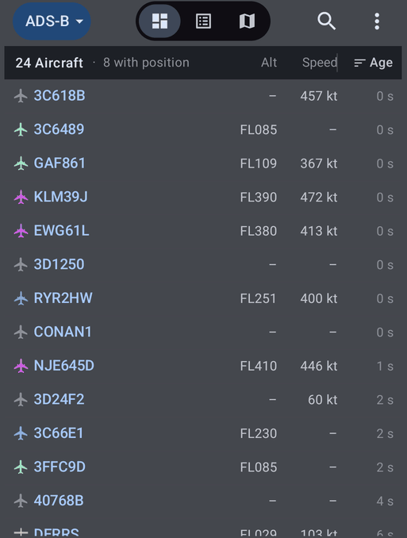
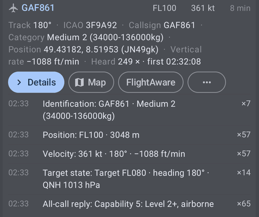
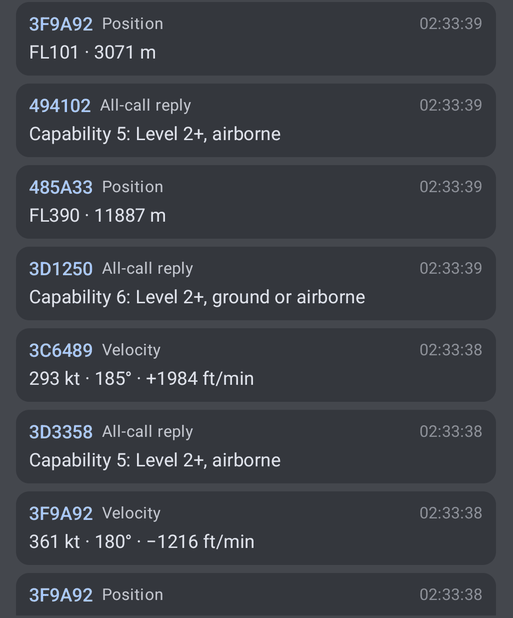
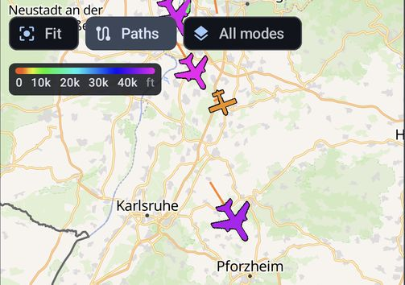

---
search:
  exclude: true
---

# ADS-B

**ADS-B** (Automatic Dependent Surveillance–Broadcast) is how aircraft tell
everyone around them where they are: about twice a second, an airliner
broadcasts its position, altitude, speed and callsign on **1090 MHz**. Air
traffic control, other aircraft and flight-tracking websites receive these
broadcasts - and so can you, with an SDR and a small antenna.

RF Analyzer decodes ADS-B and shows the aircraft in a table and on the map, with
their altitude, speed, heading and squawk code. It only receives. Most
commercial aircraft and many smaller ones send ADS-B; you can typically receive
aircraft up to 100-250 km away, depending on your antenna and their altitude.
ADS-B is part of the [Digital Extension](./digital-extension.md), which must be
installed.

---

## How ADS-B Works

### Messages

Every aircraft has a unique 24-bit **ICAO address**, written as six hex
digits (`3C6444`). Its transponder sends short pulse messages of 56 or 112 bits
at 1 Mbit/s. The long ones (*extended squitter*) carry ADS-B information, each
message one kind:

| Message | Content |
|---|---|
| **Identification** | Callsign (the flight number, e.g. `DLH4AB`) and aircraft category (light, heavy, helicopter, glider, …) |
| **Position** | Altitude and an encoded position. A position needs two messages (an "even" and an "odd" one, at most 10 s apart) to be decoded without knowing where you are. |
| **Velocity** | Speed, heading and vertical rate (climbing or descending, in ft/min) |
| **Status** | Squawk code and emergency state |
| **Target state** | What the autopilot is set to: target altitude, heading, pressure setting |
| **Operation status** | ADS-B version and accuracy of the position |
| **All-call reply** | Only the ICAO address and transponder capability: sent by every Mode S transponder, also by aircraft without ADS-B |

Every message has a 24-bit checksum, so damaged messages are recognized (one or
two wrong bits are repaired).

### Altitude, speed and squawk

- **Altitude** is shown as a flight level (`FL316` = 31 600 ft above the
  standard pressure level) or, below 1000 ft, in feet.
- **Speed** in knots (1 kn = 1.852 km/h), **heading** in degrees (0° = north,
  90° = east).
- The **squawk** is the four-digit code air traffic control assigned. Three
  codes are emergencies: **7500** (unlawful interference), **7600** (radio
  failure) and **7700** (general emergency). RF Analyzer shows them in red.

---

## Getting Started

ADS-B needs a source that can receive 1090 MHz at a sample rate of at least
2 Msps (an RTL-SDR, HackRF, Airspy or HydraSDR; not the shortwave-only
receivers). The quickest way to start is the mode button in the header of the
[Digital tab](./digital-tab.md#choosing-a-mode): tap it, then **Start** next to
**ADS-B**. RF Analyzer tunes to 1090 MHz, raises the sample rate to 2.4 Msps
or more if needed (so 1090 MHz stays clear of the receiver's DC spike) and
starts the analyzer. Recordings made at 2 Msps work too.

You can also set it up by hand: select **ADS-B** as the demodulation mode in the
Demodulation tab and set the channel frequency to 1090 MHz. There are no other
settings.

An antenna for 1090 MHz helps a lot: a simple quarter-wave whip (6.9 cm) placed
high and outdoors, or at least at a window facing the sky, receives much more
than a telescopic antenna indoors.

---

## In the Digital Tab

The aircraft show up in the [Digital tab](./digital-tab.md). That page explains
the controls all modes share; here is what ADS-B's rows and cards mean. ADS-B
has no ticker: aircraft are heard several times a second, the rows are the news.

### Overview

The **Overview** lists every aircraft, one row per ICAO address: its callsign
(or its address until it sent one) with a small aircraft symbol coloured by
altitude and the flag of its country, its altitude (**Alt**) and **Speed**, and
on wider screens its **Track** (heading). The row text only shows what is unusual: an emergency, a
squawk of 7500/7600/7700, or "On the ground". While ADS-B is received, aircraft
not heard in this session are faded; otherwise, those not heard for five
minutes.

Sort by **Last heard**, **Altitude**, **Frames** (how many messages were
received from it) or **Callsign / ICAO**. The summary says how many aircraft
have a position and, while ADS-B is received, how many messages per second
arrive ("85 msg/s") - a quick measure of how well the antenna does.

Tap an aircraft to open it:

- **ICAO** address, **Country**, **Callsign**, **Category** (size or type,
  from its identification), **Position**, **Vertical rate**, **Squawk** and
  **Data quality** (ADS-B version and how accurate its position is: NACp, SIL),
- **FlightAware** opens the aircraft on flightaware.com (where it is going,
  its type and registration); **Map** shows it on the map,
- instead of a message list, one line per **message type** with the newest
  content and how many of that type are among its last 200 messages. Tap a type
  to see its messages.

**⋯** also has **Copy summary**, a short text with everything known about the
aircraft.

The **country** is the state of registry, read from the address: ICAO gives
every state its own block of addresses (Annex 10, Volume III, Table 9-1). It is
known without any database or internet connection, also for an aircraft that
never sends a callsign. Some addresses tell no country: ICAO's own temporary
blocks, and the anonymous, TIS-B and ADS-R addresses of DF 18 messages (the row
then shows no flag, the opened aircraft says so).

### Messages

The **Raw** view shows every message as a card: the callsign (for
identification messages) or ICAO address, the message type in words, the time
and the content ("FL316 · 9632 m", "425 kt · 191° · −1472 ft/min"). An
emergency is shown in red. Tap a card for all fields; the grey line shows the
message format (DF17 = ADS-B, DF18 = ADS-B from a device without transponder or
relayed by a ground station, DF11 = all-call reply), the ICAO address and the size.

ADS-B produces many messages: RF Analyzer keeps the newest 100 000 (20 to 30
minutes near a busy airport). The aircraft stay in the Overview.

### Map

The **Map** shows the aircraft heard in the last 15 minutes, turned in their
direction of flight, sized by their category and coloured by their altitude:
orange near the ground, through yellow, green, cyan and blue to magenta at
40 000 ft and above. Grey ones are on the ground. Tap the map to see the colour
key. Aircraft not heard for five minutes fade. Tap an aircraft for its details
and **FlightAware**; **Paths** shows where they flew while you watched.

---

## Tips & Troubleshooting

- **Aircraft without a position**: the position needs an even and an odd
  position message within 10 seconds. Weak aircraft at the edge of reception
  often don't get there. Aircraft that only answer radar (Mode S without ADS-B)
  appear with their ICAO address and "All-call reply" only.
- **Aircraft without a callsign**: the identification is sent only every few
  seconds; it comes with time.
- **Few aircraft**: use an antenna made for 1090 MHz and put it high. A cheap
  LNA (amplifier) or an RTL-SDR with a 1090 MHz filter helps in cities with
  strong mobile phone signals.
- **Processing overload**: ADS-B needs a sample rate of 2 Msps or more and is
  one of the more demanding modes. Lower the FFT size and frame rate in the
  [Display tab](./fft.md) if the overload notice appears.
