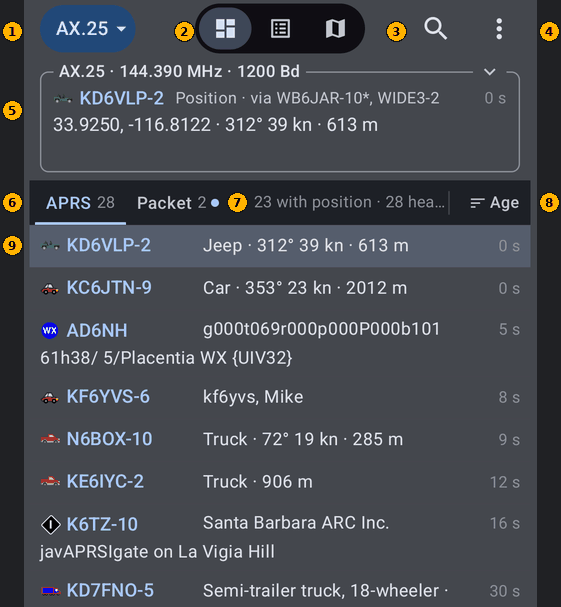
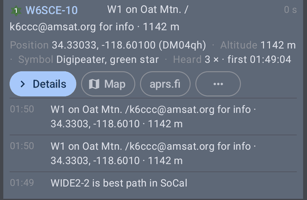
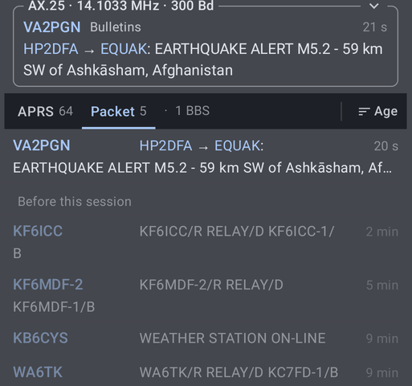
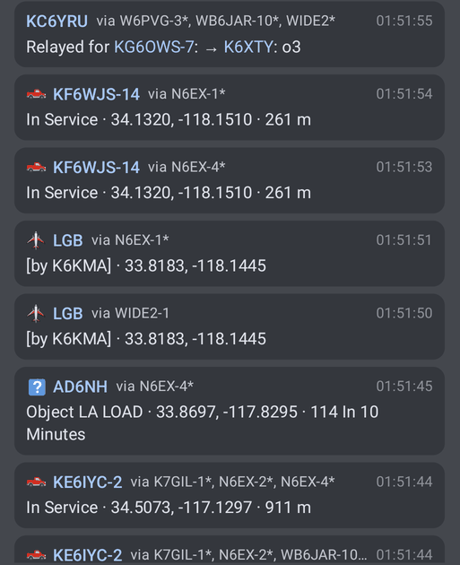
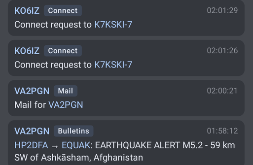
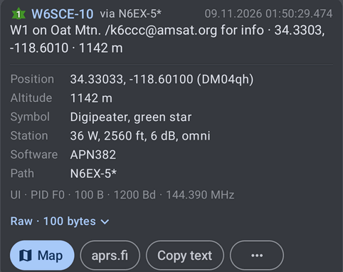
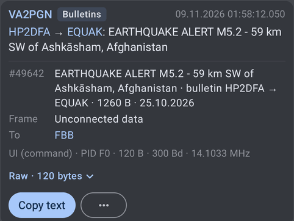
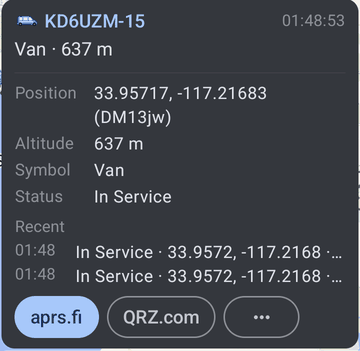

---
search:
  exclude: true
---

# AX.25 / Packet Radio

AX.25 is the protocol of amateur **packet radio**: short data frames with the
callsigns of sender and receiver in front. Most of what you hear today is
**APRS** - position reports, weather stations, short messages - but on the
shortwave bands packet radio is also used the classic way: mailboxes (**BBS**),
**nodes** that relay connections across a network, and stations connecting to
them to read and send messages.

RF Analyzer decodes AX.25 at the three usual speeds and shows every frame it
receives, the APRS stations (also on the map) and the other packet stations -
BBSes, nodes, users - with what they announce. It only receives; it does not
transmit. AX.25 is part of the [Digital Extension](./digital-extension.md),
which must be installed.

---

## How Packet Radio Works

### Frames

Everything travels in **frames**: the destination, the sender and up to eight
**digipeaters** (stations that repeat the frame; a `*` marks one that already
did), then a control field that says what kind of frame it is, and the
information. A checksum at the end protects the frame - RF Analyzer shows only
frames whose checksum is correct.

There are two kinds of traffic:

- **Unconnected** frames (`UI`) are sent to everyone: APRS reports, beacons, a
  mailbox announcing who has mail, a BBS listing its new bulletins.
- **Connected** sessions are a conversation between two stations: a connect
  request (`SABM`), the answer (`UA`), numbered information frames (`I`) that
  the other side acknowledges (`RR`), and finally a disconnect (`DISC`). This is
  how a user reads mail from a BBS or how BBSes forward messages to each other.

### What travels on top

| Traffic | What you see |
|---|---|
| APRS | position, symbol, course/speed, weather, status, messages - see the Map tab |
| Mailbox beacon ("Mail for: …") | the callsigns that have mail waiting at that BBS |
| FBB bulletin list | the BBS's new messages and bulletins: number, sender, addressee, date, title |
| Node and BBS beacons | the station's description (often a BPQ32 node: "Packet Switch", node/BBS/chat SSIDs) |
| NET/ROM routing broadcasts | the node's alias and the routes it offers |
| Connected sessions | the frame types; the text of a session where it is readable |

Binary transfers (compressed BBS forwarding, file transfers) are shown as a hex
dump only.

### Speeds

| Speed | Where | Modulation |
|---|---|---|
| **1200 Bd** | VHF/UHF (APRS 144.800 MHz in Europe, 144.390 MHz in North America, the ISS on 145.825 MHz) | tones of 1200/2200 Hz in an FM channel |
| **300 Bd** | shortwave | tones 200 Hz apart, sent as SSB (upper or lower sideband) |
| **9600 Bd** | VHF/UHF, rare | G3RUH, directly frequency modulated |

Pick the speed with the **Baud Rate** slider of the AX.25 mode (see
[Controls in the Demodulation Tab](#controls-in-the-demodulation-tab)).

---

## Where to Listen on Shortwave

These are the frequencies where packet radio was heard while the receiver was
developed (October 2026). The **channel** is the centre of the signal - see the
next section.

| Channel | Use | Heard |
|---|---|---|
| **10.1493 MHz** (30 m) | HF APRS, worldwide (dial 10.1476 MHz USB) | Europe on a Sunday afternoon: a French HF/VHF gateway every few minutes, Italian stations; nothing after dark |
| **14.1033 MHz** (20 m) | **Net105**, the North American packet network (dial 14.105 MHz LSB) | all the time in the US afternoon/evening: mailbox beacons, BBS bulletin lists, node beacons, connection attempts |
| **7.1001 / 7.1022 MHz** (40 m) | US packet nodes and BBSes | in the US evening: node and BBS beacons, a weather report, mailbox beacons |

Public KiwiSDR receivers near the activity work well, e.g. one in the eastern US
for Net105 and 40 m. Packet on shortwave is slow (300 Bd) and usually weak:
expect a frame every few minutes on a quiet channel.

## Getting Started

The quickest way to start is the mode button in the header of the
[Digital tab](./digital-tab.md#choosing-a-mode): tap it, tap **›** next to
**AX.25** and pick a station: the APRS frequency of your region (**144.800 MHz**
in Europe, **144.390 MHz** in the Americas), the **ISS** (the APRS digipeater on
the International Space Station, when it passes over you), **HF APRS 30m** or
**Net105** (HF packet). Set up your source first in the Source tab.

---

## Controls in the Demodulation Tab

- **Channel Frequency**: on VHF/UHF the APRS frequency itself (144.800 MHz).
  On shortwave the centre of the signal, see [Tuning](#tuning) below.
- **Baud Rate**: **300 (HF)** for packet on shortwave, **1200 (VHF)** for APRS
  and most VHF/UHF packet, **9600 (G3RUH)** for the rare fast VHF/UHF packet.
  Changing it also sets the channel width that fits.
- There is no squelch in the digital modes: the decoder finds the
  transmissions by itself. The channel width follows the baud rate; you can
  still drag the channel's edge in the FFT plot.

## Tuning

On shortwave, tune the **channel to the centre of the signal** - between its
two tones - not to the dial frequency packet stations quote. For the usual
tones of 1600/1800 Hz the centre is **1700 Hz above** a USB dial frequency and
**1700 Hz below** an LSB one (10.1476 MHz USB → 10.1493 MHz; 14.105 MHz LSB →
14.1033 MHz). The AX.25 presets offer HF APRS and Net105 ready
tuned.

You do not need to be exact: the receiver finds a station up to about **150 Hz**
off the channel, and every station gets its own frequency and speed estimate -
real transmitters are often tens of Hz off and their speed a little off 300 Bd.
Some web receivers show frequencies slightly off (the German KiwiSDR used during
development reads 300 Hz high at 10 MHz); tune to where you see the signal.

On VHF, tune the channel to the frequency itself (144.800 MHz).

---

## In the Digital Tab

The decoded frames show up in the [Digital tab](./digital-tab.md). That page
explains the controls all modes share; here is what AX.25's sections, rows and
cards mean.

While AX.25 is received, the **ticker** shows the newest frame: the sender
with its APRS symbol, what kind of report it is (Position, Message, Status,
Object, …) and the digipeaters it came through, and below it the report in
words. Its label shows the speed (1200 Bd). Tap it for a list of the session's
last frames.

### APRS stations

The **APRS** section lists every station and object that sent APRS. Each
callsign with its SSID (the number after the dash: `KC6JTN-9` is often a car,
`-10` an iGate) is its own row. A row shows the station's symbol and its latest
report in words: its comment or status text, or what its symbol means ("Car")
with its course, speed and altitude ("312° 39 kn · 613 m"). A message reads
"→ K6XTY: text", a report an iGate relayed for another station "Relayed for
KG6OWS-7: …". "no position" means it never sent one.

The summary says how many stations sent a position and how many were heard in
this session. Sort by **Last heard**, **Packets**, **First heard** or **Name**.

APRS **objects** - an event, a repeater, a weather alert placed on the map by a
station - get their own row under their name; the station that reported it is
shown in its facts.

Tap a station to open it:

- **Position** with its Maidenhead locator, **Altitude**, **Speed**,
  **Course**, **Symbol**; for Mic-E (the compact format of many radios) its
  **Status** (En Route, In Service, Off Duty, Emergency, …) and the **Radio**
  that sent it,
- **Heard**: how many frames and since when. Every copy a digipeater repeats
  counts, so a station heard through two digipeaters counts twice per report.
- **aprs.fi** shows the station's track and history on aprs.fi, **QRZ.com**
  looks up the callsign (without SSID), **Map** shows it on the map.
- Below, its latest frames, including messages other stations sent to it
  ("← DL1ABC: text").

### Packet stations

The **Packet** section lists every other station: mailboxes (BBS), nodes and
their users. A row shows what the station announces or does:

- "Mail for KB5YZB K5DAT": a mailbox beacon, the callsigns that have mail
  waiting at this BBS ("No mail waiting" when it lists nobody),
- "HP2DFA → EQUAK: EARTHQUAKE ALERT…": the newest entry of the BBS's bulletin
  list (sender → addressee: title),
- "Node SOLBPQ · 12 routes": a node's routing broadcast (NET/ROM),
- its beacon text,
- "Connected with KB9KC-7": it was part of a connection,
- "Called by KE0GB": a station that others tried to connect to, but that wasn't
  heard itself. Its frame count is 0.

**Role** (in the opened row on a phone) is **BBS** or **Node** when its beacons
say so. The summary counts the BBSes and nodes. Opened, a station lists its
mail, bulletins, routes, the stations it talked to and its latest frames in both
directions, so a connection reads as its sequence of frames.

### Frames

The **Raw** view shows every frame as a card: the sender with its symbol, the
digipeaters it came through ("via N6EX-1*, WIDE2-1" - a `*` marks a
digipeater that has already repeated it), the time and the report in words.
Frames that aren't APRS carry a tag:

| Tag | Frame |
|---|---|
| **Mail** | Mailbox beacon: who has mail waiting |
| **Bulletins** | A BBS's list of new messages and bulletins |
| **NET/ROM** | A node's routing broadcast: its alias and the routes it offers |
| **Text** | A beacon or other readable text |
| **Connect**, **Acknowledge**, **Disconnect**, **Refused** | Setting up and ending a connection (SABM, UA, DISC, DM) |
| **Connected** | Text sent within a connection |
| **I**, **RR**, **RNR**, **REJ**, **UI**, … | Frames without readable content (binary data, acknowledgements); the AX.25 frame type |

Tap a card for all fields:

- **Position**, **Course**, **Speed**, **Altitude**, **Symbol**: as sent.
- **Station**: the station's power, antenna height and gain ("36 W, 2560 ft,
  6 dB, omni"), if it sends them (PHG).
- **Messaging**: the station can receive APRS messages.
- **Sent**: the time stamp the station put into its report, as sent (`092345z`
  = day 9, 23:45 UTC).
- **Software**: the AX.25 destination of an APRS frame, which names the
  software or device that sent it (`APDR16` is APRSdroid, `APN382` the firmware
  of a Kantronics TNC).
- For messages **To** and **Message ID**; for telemetry the sequence number and
  the raw values; for relayed (third-party) frames the **Originator**.
- **Path**: all digipeaters, as in the header.

For other frames the fields show the content (bulletin entries with number,
title, type, sender → addressee, size and date; the routes of a NET/ROM
broadcast with their quality from 0 to 255), **Frame** (what it does) and
**To**.

The grey **radio line** shows the frame type with its sequence numbers ("I S2 R5"
= information frame number 2, acknowledging everything up to number 4; "P"/"F"
= poll/final), command or response, the protocol identifier (PID F0: plain
data, CF: NET/ROM), the frame size, the speed and the frequency.

### Map

The **Map** shows the APRS stations and objects with a position, with their
APRS symbols, turned in their direction of travel. Tap one for its latest report
and recent frames; **Follow** (in **⋯**) keeps the map on a moving station.

---

## Tips and Limits

- The 300 Bd receiver decodes signals well below what you can make out in the
  waterfall, but every frame needs every bit right: a frame that fades for a
  moment is lost. Long frames (connected sessions, up to 9 seconds) are lost
  more often than short beacons.
- A frame whose checksum failed by a few bits is repaired when the repair
  leads to a valid frame with valid callsigns; such frames are rare and look
  like any other.
- Frames are shown about one to two seconds after they end on shortwave.
- APRS is recognised only in unconnected frames whose information starts like
  APRS. A beacon in free text ("Greetings from …") is listed under the Packet
  section, not as an APRS station.
