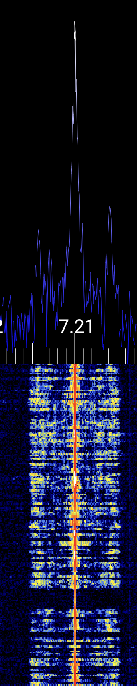
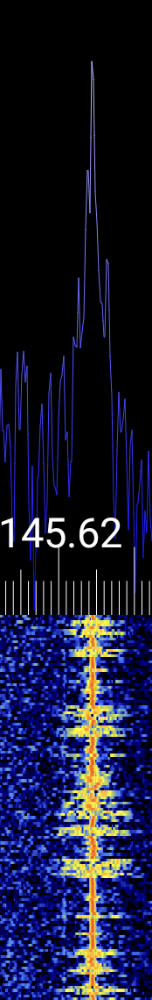
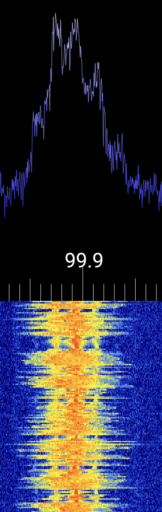
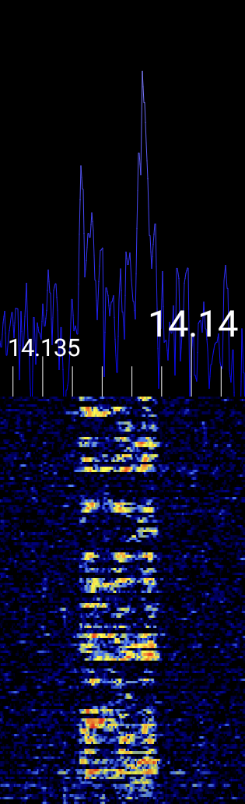
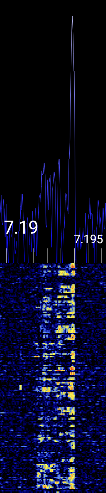
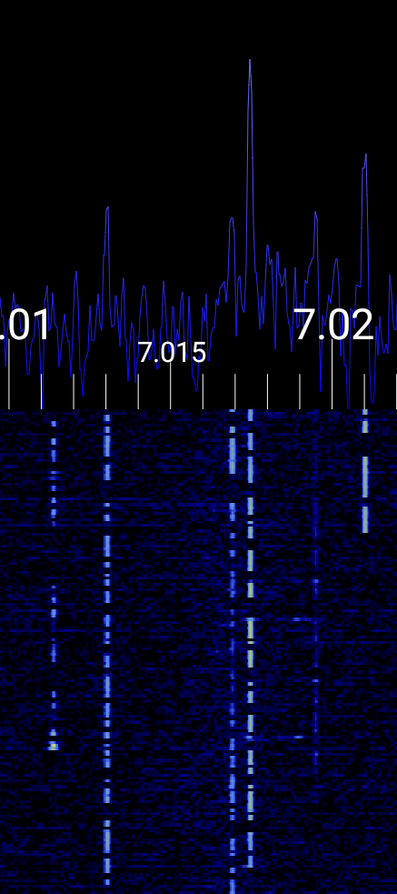

# Demodulation Tab

Once you're receiving signals with your SDR or replaying an IQ file, the
**Demodulation Tab** allows you to actually listen to and fine-tune a specific
signal. This is where you select the demodulation mode (like AM or FM), adjust
demodulation parameters and the audio level.

---

## Demodulation Mode

Picking the correct **demodulation mode** is absolutely essential. If you're
not using the right mode for a given signal, the result will be distorted audio
— or just static. The demodulator is responsible for decoding how the original
audio or data is embedded in the radio signal, and using the wrong one is like
trying to play a vinyl record with a laser pointer — you won’t get music, just
noise.

Tap the **Demodulation Mode** button at the top right: a dialog lists the
modes with their full names and what they are typically used for, and switches
demodulation off at the top. The modes are:

- **AM** - Amplitude Modulation
- **FM (narrow)** - Narrow-band Frequency Modulation
- **FM (wide)** - Wide-band Frequency Modulation
- **LSB** - Lower Side Band Modulation (Single Side Band - SSB)
- **USB** - Upper Side Band Modulation (Single Side Band - SSB)
- **CW** - Continuous Wave (or more commonly: Morse Code)

Each mode is used in different parts of the spectrum, and often the modulation
type can be guessed by **frequency** (use a **band plan**) or **visual
signature** in the FFT/waterfall. See section [Choosing the Right Demodulation
Mode](#choosing-the-right-demodulation-mode) for more information.

---

## Audio Controls

- **Speaker Icon** - Tap to mute or unmute the audio output.
- **Volume Percentage** - Tap the number to bring up a volume slider

---

## Channel Frequency

The **channel frequency** determines at which frequency the demodulator operates.
This is different from the source frequency which selects the center of the
captured spectrum. The channel frequency may be chosen anywhere inside the
received signal spectrum which is centered around the signal frequency (plus/
minus half of the sample rate in Hz)

There are several ways to set the **channel frequency**:

1. **Typing** directly into the frequency textbox. The textbox is set to insert
   mode which means it is possible to just *type over* the current value.
   Pressing enter on the keyboard or the **Apply** button sets the new frequency.
2. **Using the tuning wheel** below the textbox - swipe or fling the wheel left
   or right. It moves in steps of the **Tune Step** slider below it, which each
   mode remembers on its own (e.g. 9 or 10 kHz for AM broadcast, 12.5 kHz for
   NFM channels). (Note: the direction of the wheel can be reversed via the
   [Reverse Tuning Wheel](./settings.md#reverse-tuning-wheel) setting if desired.)
3. **Dragging the channel selector** at its yellow drag button in the FFT view.

!!! tip "Quick Tuning"
    The tuning wheel is great for small frequency changes. For larger jumps,
    it's faster to type the frequency or drag the selector in the FFT plot. It
    is possible to type a frequency which lies outside of the currently
    received spectrum. RF Analyzer then automatically retunes the SDR if
    possible.

---

## Zoom and Bandwidth

- **Zoom** - Adjust how wide or narrow the FFT/waterfall viewport appears
  relative to the bandwidth of the source spectrum. With the slider all the way
  to the left, the entire spectrum which is received from the SDR is visible.
  Sliding to the right will zoom in around the channel frequency.
- **Channel Bandwidth** (kHz) - Defines how much of the signal bandwidth around
  the channel frequency should be demodulated. This affects both audio clarity
  and how much noise or neighboring signals are picked up. The bandwidth can
  also be changed by sliding the white drag handle in the FFT view. Each mode
  has its own range and remembers its bandwidth: AM 3 - 20 kHz, FM (narrow)
  5 - 25 kHz, FM (wide) 30 - 95 kHz, LSB/USB 1.5 - 5 kHz, CW 0.1 - 0.6 kHz.

---

## Squelch Control

The **Squelch** mutes the audio while no signal is in the channel, like the
squelch of a handheld radio. It is available for the analog modes and disabled
by default. Each mode keeps its own squelch: on or off, and its level (0 to
40 dB above the noise, 10 dB by default).

The squelch level is set in **dB above the noise**: RF Analyzer measures the
noise floor next to the channel all the time, so the same setting works with
every SDR, gain and FFT size - also near the edge of the received band and in a
recording that holds only part of its band (10 dB is a good start; lower opens
on weaker signals, and on noise if too low). The squelch opens as soon as the channel is
that much above the noise, and closes only when the channel has stayed a few dB
below that for a moment - it doesn't flutter on a signal near the threshold
and doesn't cut off the end of a transmission. The beginning of a transmission,
from before the squelch noticed it, isn't lost either.

Once enabled, the squelch line appears in the channel selector of the FFT plot,
labeled with the level ("+10 dB"). It follows the noise floor in steps of
about a decibel. Slide its
drag handle up or down to change the level. The line is green while the
squelch is open and red while it is closed.

The level is measured on the channel's own side for single sideband (USB above,
LSB below the channel frequency).

The squelch can also be used to automatically start and stop the recorder (see
[Recording Options](./recording.md#recording-options)).

When you tune to a bookmarked station that stores a squelch, its setting holds
while you stay on the station: the tab shows **Settings from "…" until you tune
away**. Tap **✕** to return to your own settings right away.

If your device can't keep up with the processing, the tab shows
**Overload – samples dropped**; tap **?** for help (see
[Processing Overload](./troubleshooting.md#processing-overload)).

---

## Choosing the Right Demodulation Mode

Here are multiple ways to figure out which demodulation mode to use:

1. **By frequency range (check band plans)**  
   Many radio services operate on fixed frequency bands and are known to use specific modulation types. Amateur radio, airband, FM radio, etc. all have well-defined standards.
   Amateur radio bands and other services often have published band plans. These are useful for identifying what mode to expect at a given frequency.
    - [IARU Band Plans (Amateur Radio)](https://www.iaru-r2.org/en/reference/band-plans/)
    - [US FCC Frequency Allocations](https://www.fcc.gov/engineering-technology/policy-and-rules-division/general/radio-spectrum-allocation)
2. **Look at the FFT and waterfall display**  
   Different modes have distinctive shapes and behavior in the spectrum display. See the examples below for visual cues.

## Demodulation Mode Characteristics

### AM - Amplitude Modulation

Used for:

- Shortwave broadcasts
- Aviation (airband)
- Some CB radio

Typical bandwidth: **6-10 kHz**

Visual signature:

- Symmetrical peaks around a center frequency
- Fixed bandwidth

---

### Narrow FM - NFM

Used for:

- Ham radio voice (VHF/UHF)
- Public safety and utility comms
- Marine VHF

Typical bandwidth: **12.5-25 kHz**

Visual signature:

- Single peak with a flat top
- Steady, narrow trace in the waterfall
- Little or no visible sidebands

---

### Wide FM - WFM

Used for:

- Commercial FM radio (88-108 MHz)

Typical bandwidth: **100-200 kHz**

Visual signature:

- Broad, dense signal
- Highly modulated (busy waterfall)
- Often accompanied by strong stereo pilot tone (~19 kHz)

---

### USB - Upper Sideband

Used for:

- Ham radio SSB above 10 MHz
- Voice on HF maritime and aeronautical bands
- Audio (de-)modulation of digital modes such as FT8 or PSK31

Typical bandwidth: **2.4-3 kHz**

Visual signature:

- Only the upper side of the carrier is visible
- Sharp edge on the lower side
- No center peak (carrier suppressed)

---

### LSB - Lower Sideband

Used for:

- Ham radio SSB below 10 MHz

Typical bandwidth: **2.4-3 kHz**

Visual signature:

- Only the lower side of the carrier is visible
- Sharp edge on the upper side
- No carrier spike

### CW - Continuous Wave / Morse Code

Used for:

- Ham radio

Typical bandwidth: **~100 Hz**

Visual signature:

- Single sharp carrier wave which is switched on and off
- Morse Code pattern is visible in waterfall (dashes and dots)

## Further Resources for Signal Identification

If you're unsure about the type of signal you're observing, the following resources can assist you in identifying various RF signals, including analog audio:

- **Signal Identification Wiki**
  A comprehensive community-driven guide featuring audio samples and waterfall images for a wide range of signals: 
  [sigidwiki.com](https://www.sigidwiki.com/wiki/Signal_Identification_Guide)

- **HFUnderground Signal Identification**  
  Focused on HF and MW bands, this wiki includes detailed entries with mode, frequency, bandwidth, and visual characteristics: 
  [hfunderground.com](https://www.hfunderground.com/wiki/index.php/Signal_Identification)

- **Tektronix eGuide to RF Signals**  
  Offers insights into interpreting spectrograms and understanding signal behavior over time: 
  [Tektronix eGuide to RF Signals](https://www.tek.com/en/documents/how-guide/eguide-rf-signals)

- **Understanding the RF Spectrum - Visual Guide**  
  A YouTube video that provides a visual walkthrough of the RF spectrum and common signal types.
  [Watch on YouTube](https://www.youtube.com/watch?v=heCwyGVAYV0)

---

## Wrapping Up

Now you are able to demodulate audio signals. Developing a good intuition of
recognizing signal modulation settings by analyzing the FFT and waterfall comes
naturally with time! A good way to practice is to record a brief period of IQ
samples on an Amateur Radio band and replay it in a loop. Then it is easy to
experiment with the various demodulation settings.

Continue on to [Recording](./recording.md).
