---
search:
  exclude: true
---

# The Digital Tab

Everything the [Digital Extension](./digital-extension.md) decodes shows up in
the **Digital** tab of the control drawer. It shows one mode at a time, in three
views:

- **Overview**: one row per station, aircraft, pager, vehicle or node: what it
  sent last and when. Open a row for everything known about it and its
  messages.
- **Raw**: every single packet as it was received, newest first.
- **Map**: everything that reported a position.

All decoded data is stored on the phone. The tab works the same whether the mode
is being received right now or you are looking at what was received yesterday.
This page explains the controls that all modes share. What a mode's rows, cards
and fields mean is explained on the mode's own page (⋮ → **Help** opens it).

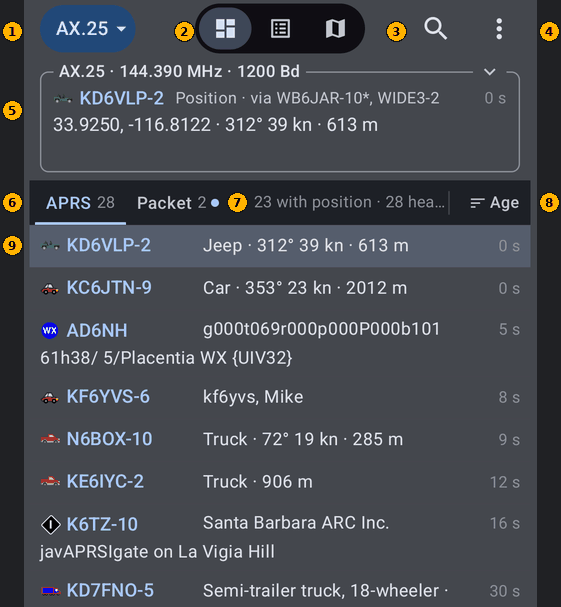

1. **Mode button**: which mode is shown. Tap it to show another mode or to start
   one, see [Choosing a Mode](#choosing-a-mode).
2. **View switch**: Overview, Raw and Map.
3. **Search and filter**, see [Search and Filter](#search-and-filter).
4. **⋮ menu**: sort order and map options of the current view, **Share…**,
   **Delete…** and **Help**.
5. **Ticker**: what is being received right now, see [The Ticker](#the-ticker).
6. **Section tabs** of a mode with several kinds of objects (here APRS stations
   and other packet stations), each with its number of rows. A dot marks a tab
   whose objects were heard since you last looked at it.
7. **Summary**: a few figures about the list, here how many stations sent a
   position and how many were heard in this session.
8. **Sort control**: what the last column shows and the list is sorted by.
9. **Rows**, see [Overview](#overview).

Pull the drawer up to see more rows; the ticker then gets more lines too.

---

## Choosing a Mode

The **mode button** names the mode whose data is shown. Its look tells you
whether that mode is being received:

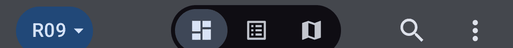

- **Filled**: this mode is being received. New packets appear as they come in.
- **Outlined with a clock icon**: you are looking at stored data. Nothing new
  arrives, either because the analyzer is stopped or because another mode is
  being received.

Tap the button to open the list of digital modes:

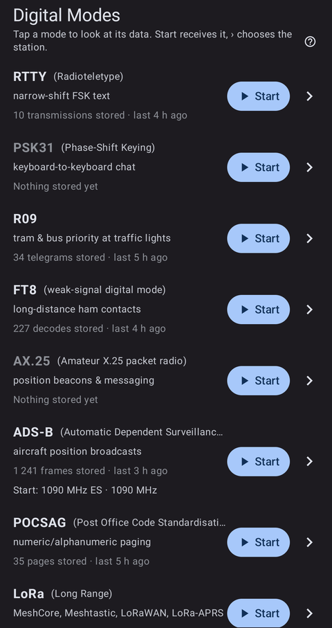

Each mode shows its name, what it is used for and how much of it is stored
("61 telegrams stored · last 8 min ago"). The mode shown at the moment has a
check mark. There are three things to do with a mode:

- **Tap the mode** to look at its stored data. This changes nothing about what
  is being received: you can browse yesterday's APRS stations while FT8 keeps
  decoding. A mode with nothing stored is greyed out.
- **Tap Start** to receive the mode on the station you started it with last
  (shown below the mode: "Start: FT8 20m · 14.074 MHz"). A mode you haven't
  started yet opens its stations instead.
- **Tap ›** to choose a station:

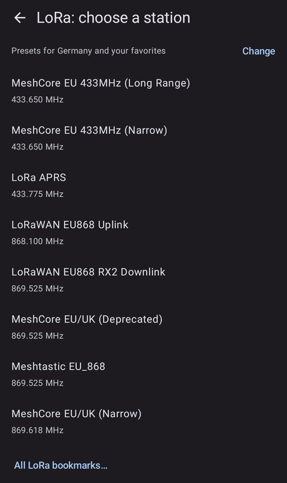

The stations are the presets of the [Digital Stations](./bookmarks.md#digital-stations)
list for your country or region (see [Location](./settings.md#location)) and
your favorite bookmarks of the mode; with your position set, the nearest come
first (R09 cities, for example). **Change** opens the location. **All …
bookmarks** opens the Bookmark Manager with every bookmark of the mode - to have
one of them here, mark it as favorite.

Starting a station selects the mode, tunes the channel, sets the channel width
and the station's settings (for example the baud rate), raises the sample rate
if the mode needs more, retunes the source if the station isn't received yet,
and starts the analyzer. The view only moves if the station isn't visible in
it. The tab switches to the mode; for a mode with several sections (LoRa's
networks, AX.25's APRS and packet stations) the Overview shows the section of
the first packet received.

The mode being received says **Receiving on** and its frequency, and offers
**Stop** instead of Start:

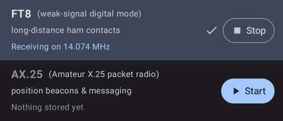

Good to know:

- Set up your source first (Source tab). With a **recording** as the source,
  Start can't retune: it only moves the channel within the recorded band, and
  tells you if the recording doesn't cover the target ("The file (144366 -
  144414 kHz) doesn't cover APRS 144.800 MHz"). Then set the mode up by hand in
  the Demodulation tab.
- While a recording is running, a station outside the recorded band (or, for a
  baseband recording, another channel) asks to stop the recording first.
- The tab follows the Demodulation tab: when you select another digital mode
  there, the Digital tab shows it. Selecting an analog mode leaves the tab on the
  last digital mode.
- The **?** at the top of the list opens this section of the manual.

---

## Overview

The Overview lists the **objects** a mode tracks: one row per station, aircraft,
capcode, vehicle or mesh node, built from all packets received from it. RTTY and
PSK31 are the exception: each row is one received transmission.

A row shows, from left to right:

- the **identity**: callsign, name, address or capcode, with a symbol where the
  mode has one (APRS symbol, country flag, aircraft type),
- what the object **sent last**, in words. Text that doesn't fit continues on a
  second line,
- short **value columns** where the mode has them (for example R09's Kurs and
  Meldepunkt, ADS-B's altitude and speed). Columns that don't fit on a narrow
  screen are listed in the opened row instead,
- the **last column**: how long ago it was heard ("8 s", "5 min", "3 h", "11 d"),
  or the value the list is sorted by.

A row **flashes** when its object is heard again (not for RDS and ADS-B, which
are heard several times a second). While the list is sorted by last heard and
you are at the top, new arrivals come in at the top and the list follows them.
When you have scrolled down or opened a row, the list stays where it is; the
**^** button takes you back to the top.

The header line above the rows gives the number of rows ("70 Calls"; while a
filter is set "12 of 67 Calls") and a short **summary**, for example how many
stations sent a position, the continents of FT8 stations or the number of
repeaters. Each mode's page explains its figures. Modes with
[sections](#sections) show the number of rows on each section's tab instead.

### Sections

AX.25 and LoRa list more than one kind of object, each in its own **section**:
AX.25 has **APRS** and **Packet**, LoRa has **MeshCore**, **Meshtastic**,
**MeshCom**, **LoRaWAN** and **LoRa-APRS**. The section tabs in the header line show how many
rows each section has; a **dot** marks a section that has heard something since
you last selected it. The tabs scroll sideways if they don't fit. The ticker
above them shows everything the mode receives, whatever section is selected.

### Sorting

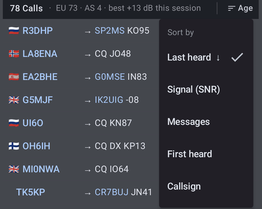

Tap the **sort control** at the right of the header line to pick the order. The
options depend on the mode; all have **Last heard** (the default, newest first)
and a name or number order. The last column of each row shows the value the
list is sorted by, so "SNR" puts the signal strength there. Sorted by name, the
column keeps showing the age. Pick the selected option again to reverse the
order; the arrow next to it shows the direction.

### This Session and Before

While the shown mode is being received, the Overview separates what was heard
in this **session** (since the analyzer was started) from what was heard
before:

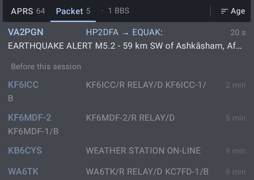

Rows not heard in this session are drawn faded below the divider
**Before this session**. When you look at stored data, nothing is faded, except
ADS-B aircraft that haven't been heard for five minutes.

### Opening a Row

Tap a row to open it:

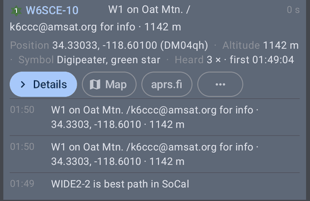

- **Facts**: what the row has no room for, as one running text: position,
  type, signal, first heard and so on. "Heard 3 × · first 01:49:04" is how many
  packets were received from it and when the first one arrived.
- **Buttons**: **Details** (see below), **Map** for an object with a position,
  and lookups such as **aprs.fi**, **QRZ.com**, **PSKReporter** or
  **FlightAware**. Lookups open the website in your browser.
- **⋯**: more actions, for example copying the callsign, sharing the object as
  JSON or opening its position in your maps app.

  
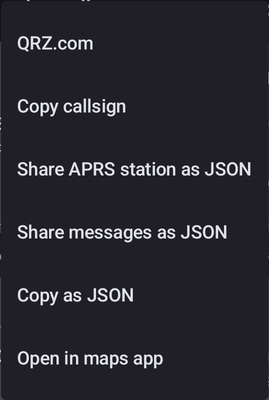

- The **latest messages** of the object, newest first. Tap one to open its card
  right there (see [Raw](#raw) for what a card shows). While a card is open,
  the list holds still; "2 new messages - tap to show" brings in what arrived
  meanwhile. "+12 older - all on the details page" leads to the details page.

Tap the row again to close it. A **long press** on a row opens the same actions
as a menu, without opening the row.

### Details Page

**Details** shows the object on a page of its own, with all its facts, all its
actions and its stored messages: the newest 200, and "Show 200 more" at the end
reads further back, as far as the object's messages are stored. The back arrow
or your phone's back gesture returns to the list where you left it.

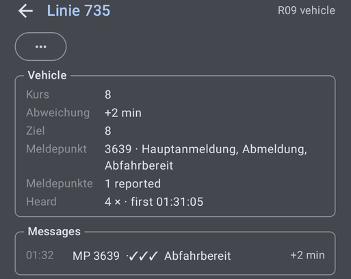

### The Ticker

While the shown mode is being received, the **ticker** above the list shows the
newest packet: who sent it and what it says. Its border label names the mode,
the frequency and, where it varies, the speed ("AX.25 · 144.390 MHz · 1200 Bd").
The border flashes when a new packet arrives, and the age counts up. Until the
first packet of a session it says "Listening on 144.390 MHz…".

The ticker has one line at the drawer's normal height and up to three when you
pull the drawer up. Where there is more to read, a **chevron** in its border
shows that it opens: tap it to see

- the text being received, at more length: RTTY and PSK31,
- a log of the session's last packets, newest on top: AX.25, LoRa and POCSAG.

FT8 and ADS-B have no ticker: their rows are the news. The ticker is not
affected by the search and filter.

---

## Raw

The Raw view shows every stored packet of the mode as a **card**, newest first
(⋮ → **Oldest First** reverses the order).

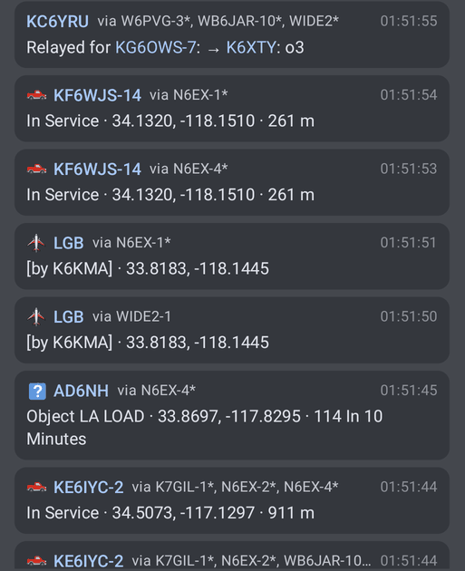

A closed card has one header line and the content:

- the **identity** of the sender, with its symbol,
- a small **subtitle**: the kind of packet, the channel, the path it took,
- a **tag** where the type is part of the message (for example an R09 report
  type or an FT8 contest message),
- a **warning** in red when something is wrong, such as **CRC error** (the
  packet arrived damaged) or **Emergency**. Nothing is shown when everything is
  fine,
- the **time**: "20:13:39" today, "06.11. 20:13" on an earlier day,
- below it the **content** in words, up to three lines.

Tap a card to open it:

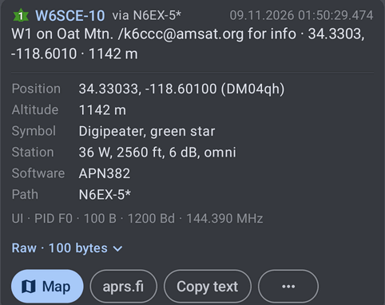

- The time becomes the full date and time, to the millisecond.
- The **fields** list everything the packet says, including what the header line
  had to shorten.
- The small grey **radio line** below them describes the reception: for example
  the frame type, the speed, the signal-to-noise ratio, how far the signal was
  off the channel, and the frequency.
- **Raw · 100 bytes** opens the packet's bytes as a hex dump, for those who want
  to check the decoding.
- The **buttons**: **Map**, lookups, **Copy text**, **Share as JSON**, and in
  **⋯** **Copy as JSON** and more. A long press on a card opens the same actions.

While you read further down, new packets don't move the list: a button counts
them ("5 new") and takes you back to the top.

---

## Map

The Map shows everything of the shown mode that reported a position: APRS and
LoRa-APRS stations, FT8 stations (at the centre of their grid square), MeshCore
and Meshtastic nodes, MeshCom stations, and aircraft. Pagers, R09 vehicles, RDS stations,
LoRaWAN devices and packet BBSes and nodes send no position.

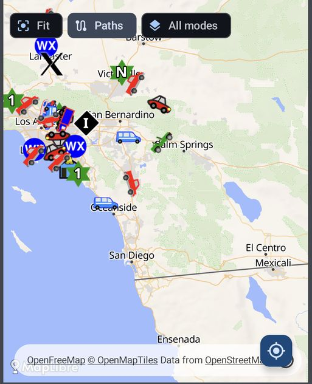

- The first time you open a mode's map, it zooms to what was heard recently
  (in this session while the mode is received, else within a day of the newest).
  Without any positions, it shows your area from [Settings → Location](settings.md#location):
  your grid locator's square (drawn on the map as your home), your device's
  location, or your country. After that it stays where you put it, also when
  new positions arrive. Each mode keeps its own map position while the app runs.
- **Tap a marker** to see the object's latest data, its recent packets and its
  actions. Tap the card to close it. For APRS stations, **Follow** (in **⋯**)
  keeps the map on the moving station until you move the map yourself.
- **Tap an empty spot** to show the map controls for a few seconds:
  **Fit** zooms to the recent markers (to your area if there are none),
  **Paths** shows the tracks of moving objects, **All modes** shows the objects
  of every mode at once. The button at the bottom right moves the map to where
  the phone is right now, to about 2 km; it needs the location permission. For ADS-B, a colour
  key of the altitudes appears too. The same options are in the ⋮ menu.
- A faded marker was not heard in this session (or, for aircraft, not in the
  last five minutes).
- **Map** in an opened row, on a card or in a popup switches to the map and
  follows that object.
- Paths are drawn from the positions received while the app runs; they are not
  stored.

Map data: © OpenFreeMap, © OpenMapTiles, data © OpenStreetMap contributors. The
map tiles are loaded from the internet.

---

## Search and Filter

Tap the **magnifying glass** to show the filter row. A dot on it means a filter
is set, also when the row is hidden. The filter applies to all three views, so
the Map shows exactly what the Overview lists.

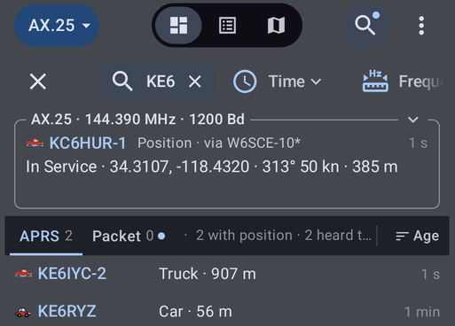

- **Search**: type part of a callsign, name, address or text. It matches
  anything the decoded data contains, not case-sensitive. The Overview lists the
  objects that match; the Raw view lists the packets that match, plus all
  packets of the matching objects (so searching for an aircraft's callsign
  also finds its position frames, which don't contain the callsign).
- **Time**: **Last hour**, **Last 24h**, **Last 7d** or **All time**, or a
  custom range with **From** and **To** (date and time). An object is listed
  if it was heard at least once in the range.

  
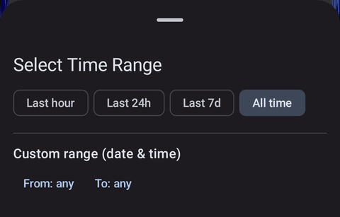

- **Frequency**: a start and end frequency. Useful when you received the same
  mode on several channels, for example FT8 on several bands.
- **✕** clears all filters (the shown mode and the sort order stay).

While a filter is set, the header line says how many rows match ("12 of 67
Calls"; the section tabs of AX.25 and LoRa count only the matching rows) and an
empty list says so ("No calls match the filter.").

---

## Sharing and Exporting

Every packet, object and list can be shared as **JSON**, a text format that
spreadsheets, scripts and other programs can read:

- **A packet** (its card): **Copy text** copies the content as you see it,
  **Share as JSON** and **Copy as JSON** the packet with all its fields.
- **An object** (its row, details page or map popup): **Share … as JSON** shares
  what is known about it, **Share messages as JSON** all its stored packets,
  **Copy as JSON** copies the object.
- **Many packets**: ⋮ → **Share…** shares the packets that match the filter
  (a search: just the search results),
  all packets of the shown mode, or every stored packet, as one JSON file. Pick
  the app to send it to (mail, cloud storage, a messenger, ...).

Each packet in the JSON has the mode, the time (in UTC, ISO 8601), the
frequency, the object it belongs to, the received bytes as hex (`raw`), the
reception details (`phy`) and the decoded content (`data`).

---

## Deleting Data

⋮ → **Delete…** clears **everything recorded for the shown mode**, or
**everything, all modes**: the packets and the objects built from them. This
can't be undone.

## How Much Is Stored

Packets are stored without a time limit, but for the modes with many packets the
oldest are removed when a mode reaches its limit:

| Mode | Packets kept | About |
|---|---|---|
| RDS | 20 000 | 30 minutes of one station |
| ADS-B | 100 000 | 20 to 30 minutes near a busy airport |
| FT8 | 200 000 | a day of continuous decoding on a busy band |
| AX.25, LoRa | 100 000 each | days to weeks |
| RTTY, PSK31, R09, POCSAG | all | |

The objects (stations, aircraft, ...) stay when their old packets are removed,
with their counts and last known state.

---

## Replaying Recordings

Recordings are decoded like live signals (see
[Recordings](./digital-extension.md#recordings)). How the tab treats their time
depends on the mode:

- **FT8 and LoRa** packets carry the time of the recording. While a recording
  plays, the tab counts in the recording's time: ages, the session, the ticker
  and the order of the Raw list follow the playback as if it were received
  now. Afterwards the packets keep their original date.
- **All other modes** stamp a packet with the time it was decoded, also when it
  comes from a recording.

---

## Processing Overload

If the phone can't keep up with the signal, the tab shows a notice over its
content:

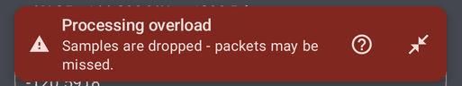

**?** explains what helps (see
[Processing Overload](./troubleshooting.md#processing-overload)). The second
button minimizes the notice to a red **!** next to the search button; tap it to
see the notice again. It disappears half a minute after the overload ends.

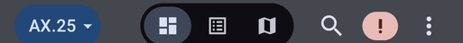

---

## Tips & Troubleshooting

**Nothing appears**

- Look for a notice below the header: it says when the extension is missing,
  needs an update or doesn't respond (see
  [When Digital Modes Can't Be Received](./digital-extension.md#when-digital-modes-cant-be-received)).
- Check that the mode button is filled: only then is the shown mode being
  received. If it's outlined, tap it and **Start** the mode.
- The ticker says "Listening on …" until the first packet arrives. Look at the
  waterfall: is there a signal in the channel? See the mode's page for typical
  frequencies and what its signals look like.
- Check that no filter is set (a dot on the magnifying glass).

**A mode in the list is greyed out**: nothing of it is stored yet. You can still
start it.

**Old data is mixed with new data**: while the mode is received, everything
heard before this session is faded below **Before this session**. To see one
period only, use the **Time** filter; to start over, ⋮ → **Delete…**.

**The list doesn't move although packets arrive**: it follows new arrivals only
when it is sorted by **Last heard**, scrolled to the top and no row is open.
