---
search:
  exclude: true
---

# FT8

FT8 is the most widely used digital mode in amateur radio. Radio amateurs use it
to make contacts over long distances with modest equipment: a few watts and a
simple wire antenna can reach other continents, because FT8 signals can still be
decoded far below the level where you could hear them. At almost any time of the
day, some shortwave band is busy with FT8 stations from all over the world.

That makes FT8 a great way to explore radio propagation with RF Analyzer: within
a minute you see which stations you receive, where they are, and how strong they
come in. RF Analyzer only receives and decodes FT8; it does not transmit.

All you need is a receiver for the HF bands (1.8 to 30 MHz): an SDR that covers
them, or one of the many public KiwiSDR web receivers, which needs no hardware at
all (see [KiwiSDR](./sdr-source.md#kiwisdr-specific-settings)). FT8 is part of
the [Digital Extension](./digital-extension.md), which must be installed.

---

## How FT8 Works

### Everyone transmits at the same time

FT8 runs on a strict schedule: time is divided into **15-second periods**,
starting at :00, :15, :30 and :45 of every minute (UTC). Every station starts
its transmission 0.5 seconds into a period and is done after 12.6 seconds. The
rest of the period leaves time to decode and decide on the reply. Stations take
turns: one transmits in the "even" periods, its partner in the "odd" ones.

Because everyone transmits at the same time, dozens of stations share one 3 kHz
wide channel, side by side in frequency. In the waterfall, each transmission is
a short vertical trace about 50 Hz wide, and all of them start and stop together
(see the screenshot under [Controls](#controls-in-the-demodulation-tab)).

### Small messages, strong error correction

An FT8 signal switches between 8 tones, 6.25 Hz apart. Each transmission carries
only 77 bits: just enough for two callsigns and a short piece of information,
such as a grid square or a signal report. To this, the sender adds a checksum
and plenty of redundancy for error correction. Three fixed tone patterns (at the
beginning, middle and end) let the receiver find each signal in time and
frequency. This is what makes FT8 so robust: RF Analyzer decodes signals down to
about **-20 dB** signal-to-noise ratio, far below what you can hear.

### A typical contact

A complete contact takes six periods, about one and a half minutes. On the air,
the called station comes first and the sender second. RF Analyzer shows each
message as **From → To**.

| Message on the air  | Meaning                                                              |
|---------------------|----------------------------------------------------------------------|
| `CQ K1ABC FN42`     | K1ABC calls "CQ" (anybody?) from grid square FN42                    |
| `K1ABC DL9XYZ JO62` | DL9XYZ answers and sends its own grid square                         |
| `DL9XYZ K1ABC -15`  | K1ABC receives DL9XYZ with -15 dB (the signal report)                |
| `K1ABC DL9XYZ R-12` | DL9XYZ confirms ("R" for roger) and reports -12 dB                   |
| `DL9XYZ K1ABC RR73` | K1ABC confirms and says goodbye ("73" means "best regards")          |
| `K1ABC DL9XYZ 73`   | DL9XYZ says goodbye, the contact is complete                         |

**Grid squares** (Maidenhead locators such as `JO62`) describe a station's
location to about 1° of latitude and 2° of longitude. That's roughly 100 × 150 km.

### Where to find FT8

FT8 uses fixed frequencies on every band. Each one is the "dial frequency" of a
receiver in USB mode; the signals sit between 100 Hz and 3 kHz above it.

| Band  | Frequency  | | Band | Frequency  |
|-------|------------|-|------|------------|
| 160 m | 1.840 MHz  | | 17 m | 18.100 MHz |
| 80 m  | 3.573 MHz  | | 15 m | 21.074 MHz |
| 60 m  | 5.357 MHz  | | 12 m | 24.915 MHz |
| 40 m  | 7.074 MHz  | | 10 m | 28.074 MHz |
| 30 m  | 10.136 MHz | | 6 m  | 50.313 MHz |
| 20 m  | 14.074 MHz | | 2 m  | 144.174 MHz |

**20 m** and **40 m** are the busiest bands. As a rule of thumb, the higher bands
(20 m and up) are open during the day and the lower ones (40 m and down) at night.

---

## Getting Started

The quickest way to start is the mode button in the header of the
[Digital tab](./digital-tab.md#choosing-a-mode): tap it, tap **›** next to **FT8** and
pick a band (later, **Start** starts the band you used last). RF Analyzer tunes
to the band's FT8 frequency, selects the FT8 mode and starts the analyzer. Don't forget to select and set up your source
first (for example a KiwiSDR) in the Source tab.

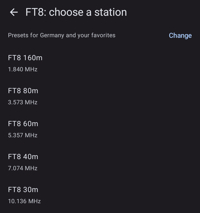

You can also set it up by hand: select **FT8** as the demodulation mode in the
Demodulation tab and set the channel frequency to the band's FT8 frequency.

Messages appear once per period, a second or two after the period ends. With
the default timing (Automatic), the first period can be lost while RF Analyzer
finds the timing, so give it up to half a minute.

---

## Controls in the Demodulation Tab

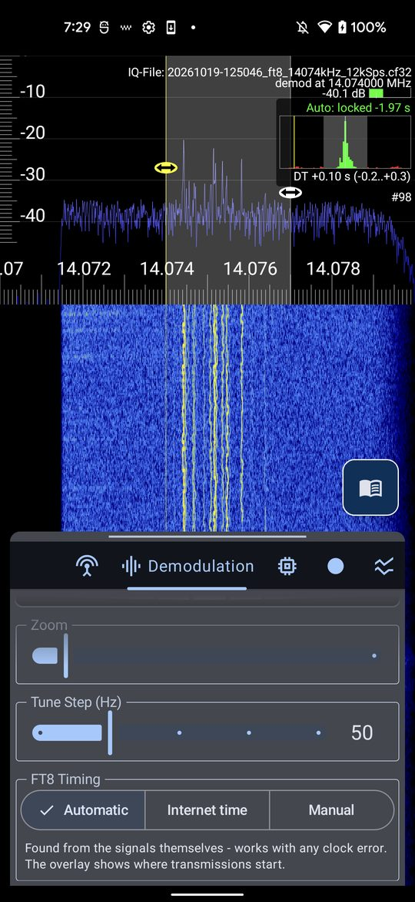

- **Channel Frequency**: the FT8 frequency of the band (the dial frequency).
  The channel is the grey area in the spectrum, 3 kHz wide, starting at this
  frequency. Everything in it is decoded at once, so you don't tune to individual
  stations.
- **Zoom** and **Tune Step** work as in the other modes (see
  [Demodulation Tab](./demodulation.md#channel-frequency)).
- **Audio Volume**: you can listen to the channel like a USB receiver and hear
  the FT8 tones. Decoding doesn't need audio.
- **FT8 Timing**: how RF Analyzer finds the start of the periods, see
  [Timing](#timing) below.

---

## Timing

The decoder needs to know where the 15-second periods start in the received
signal. It looks for transmissions starting up to 2.5 seconds early or late. If
the timing is off by more, nothing is decoded, and even a smaller error costs
weak signals. Three things can throw the timing off:

- **The phone's clock**: Android lets the clock drift by up to 2 seconds
  before it corrects it.
- **The receive chain**: samples from a web receiver arrive later than they
  were received.
- **Recordings**: the start time of a recording is often not known exactly.

You choose how RF Analyzer handles this with **FT8 Timing** in the Demodulation
tab:

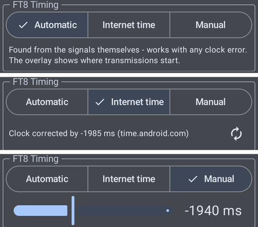

- **Automatic** (recommended, the default): RF Analyzer finds the periods from
  the signals themselves. It watches where in the 15-second cycle transmissions
  start and aligns the periods to that. This needs no decoded message, so it
  works with any clock error, also for recordings whose start time is unknown.
  Once messages are decoded, it fine-tunes the timing from them and then follows
  slow drifts. It usually locks within one or two periods. If nothing has been
  decoded for two minutes (for example after you changed the band), it starts
  searching again.
- **Internet time**: uses the time stamps of the received samples as they are.
  For an SDR connected to the phone, that is the phone's clock: RF Analyzer
  corrects it with an internet time server (time.android.com or time.google.com) as
  soon as you select this mode. The line below the buttons shows the correction;
  the button on the right repeats the sync. KiwiSDR receivers with GPS stamp
  their samples with the exact GPS time. Recordings carry the time stamps they
  were recorded with. Choose this mode if you want the timing to be independent
  of the signals: then the DT values show the real clock errors of the
  transmitting stations.
- **Manual**: a fixed correction you set with the slider (-7500 to +7500 ms).
  Use it if you know the error of your time source. The
  [timing indicator](#the-timing-indicator) shows the right setting.

---

## The Timing Indicator

While FT8 is running, the top right corner of the spectrum shows the timing
indicator. It shows where in the 15-second cycle transmissions start, and
whether that fits the timing in use:

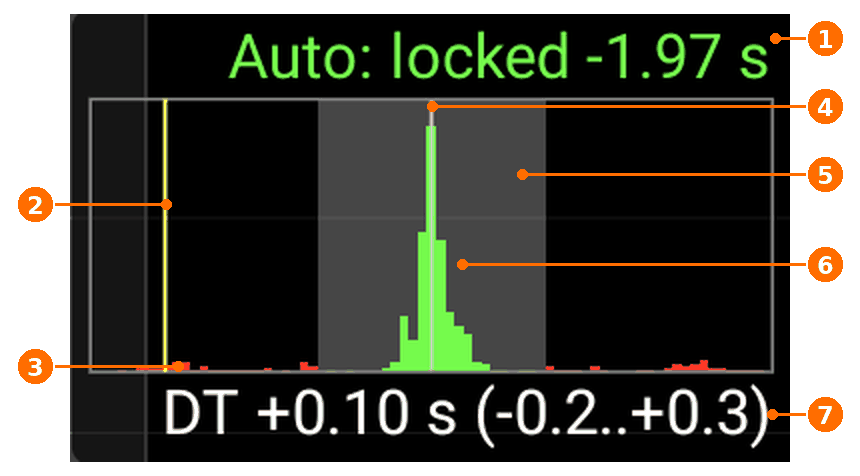

1. **Timing mode and correction**: *Auto: searching* while Automatic is still
   looking for the periods, *Auto: locked* once decoded messages confirm them,
   or *Internet time* / *Manual*. The number is the correction in use.
2. **Now** (yellow line): where in the cycle the newest received samples are.
   It sweeps from left to right once every 15 seconds.
3. **Red bars**: transmissions that start outside the search band. They
   cannot be decoded.
4. **Nominal start** (centre line): 0.5 seconds after the period boundary,
   where the transmissions should start. The box shows one full 15-second cycle,
   centred on this line.
5. **Search band** (grey): the start times the decoder searches, 2.5 seconds
   before and after the nominal start.
6. **Transmission starts** (green bars): how many transmissions start at each
   point of the cycle, averaged over the last periods. The taller, the more
   stations.
7. **DT of the recent decodes**: the median and, in brackets, the range of
   most of them. DT is how much later (or earlier, if negative) than the nominal
   start a transmission began.

**With correct timing, the bars form one green peak on the centre line**, and DT
is close to zero. Most stations transmit within a few tenths of a second of the
nominal start, so the peak is narrow.

### Examples

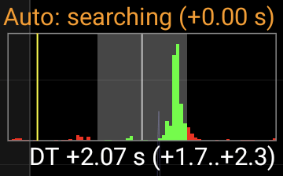

**Automatic, just started.** This is a recording made with a phone clock that
was 2 seconds fast. The transmissions start 2 seconds late, at the edge of the
search band. Only some of them can be decoded, and their DT is +2.07 s.

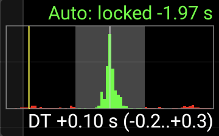

**One period later**, Automatic has found the error and corrects it by -1.97 s.
The peak sits on the centre line and DT is +0.10 s.

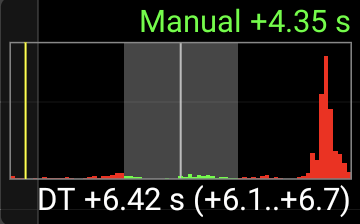

**Manual with a wrong setting** (+4.35 s): the peak is outside the search band
and red, so nothing is decoded. For a while, the DT line still shows the last
decodes, recalculated for the new setting: +6.42 s.

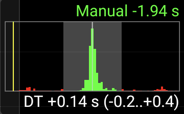

**Manual, set correctly** (-1.94 s): the peak is back on the centre line.

!!! tip "Setting Manual timing"
    Move the slider until the green peak sits on the centre line. The DT line
    tells you how far to go: if it shows +2.1 s, lower the setting by about
    2100 ms. The peak moves right away; the DT values follow with the next
    decoded period.

---

## In the Digital Tab

The decoded messages show up in the [Digital tab](./digital-tab.md). That page
explains the controls all modes share; here is what FT8's rows and cards mean.
FT8 has no ticker: a new period's messages arrive all at once, a second or two
after the period ends, and the rows they update flash.

### Overview

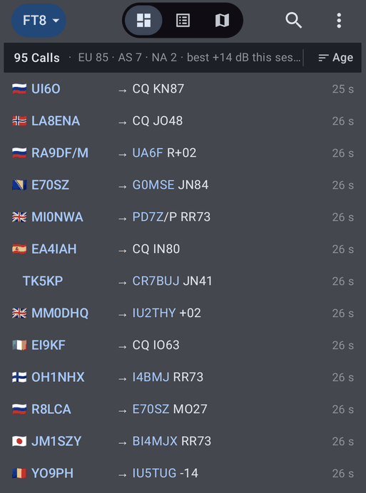

The **Overview** lists every station heard transmitting ("Calls"), the most
recently heard first. Each row shows the country flag (from the callsign
prefix), the callsign, its last message without its own callsign - "→ CQ KN87"
is a CQ call from grid square KN87, "→ G0MSE JN84" an answer to G0MSE - and the
time since it was last heard. Callsigns in the message are highlighted.

The header line counts the stations and how many come from each continent (EU,
NA, SA, AS, AF, OC; stations whose prefix RF Analyzer doesn't know are not
counted), followed by the best SNR heard (in this session while FT8 is
received). Sort the list by **Last heard**, **Signal (SNR)** (the last SNR,
strongest first), **Messages** (how many messages it sent), **First heard** or
**Callsign**.

A station only gets a row for messages it sent. A station that is only called by
others has none, nor do free-text and telemetry messages, which carry no
sender.

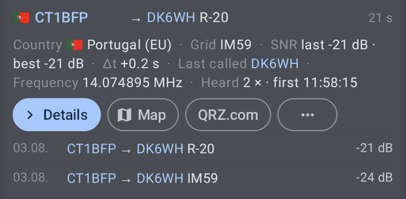

Tap a station to open it:

- **Country** (with continent) and **Grid**, the grid square it sent last,
- **SNR**: the last and the best signal-to-noise ratio,
- **Δt**: how many seconds after the nominal start its last transmission began
  (see [The Timing Indicator](#the-timing-indicator)),
- **Last called**: the station it called last,
- **Frequency**: where in the band it transmits (dial frequency plus its audio
  offset),
- **Heard**: how many messages it sent and when it was first heard.

The buttons: **Details**, **Map** (for a station that sent a grid square) and
**QRZ.com**; **⋯** has **PSKReporter** (where else the station is received),
the QRZ.com page of the station it called, copying the callsign and sharing as
JSON. The list below shows its latest messages in **both directions** - the
ones it sent and the ones addressed to it - with their SNR. Tap one to open it.

### Raw

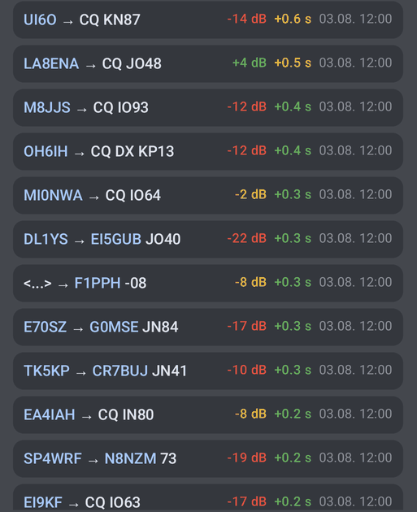

The **Raw** view shows every decoded message as a one-line card, newest first:

- the message, as **From → To** and its content,
- a tag for the less common message types (see below),
- the **SNR**: the signal-to-noise ratio in dB, measured in a 2.5 kHz bandwidth
  like in WSJT-X. Green from 0 dB, amber from -10 dB, red below.
- the **Δt** (DT in WSJT-X): how many seconds after the nominal start the
  transmission began. Green within ±0.5 s, amber within ±1.5 s, red beyond.
- the time the transmission started.

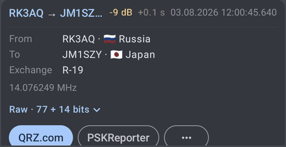

Tap a card to see both stations with their countries, the **Exchange** (the
report or grid square), the grid square's position, the message **Type**, the
frequency and the received bits (**Raw · 77 + 14 bits**: the message and its
checksum). **QRZ.com** and **PSKReporter** look up the sender; **⋯** has the
same for the other station.

| Type | Message |
|---|---|
| *(no tag)* | Standard message: two callsigns plus a grid square, a report, `RRR`, `RR73` or `73`; also messages with a non-standard callsign (e.g. a special event station) |
| **EU VHF** | Like a standard message, with portable (`/P`) callsigns |
| **Free text** | Free text, up to 13 characters |
| **DXpedition** | DXpedition mode: one rare station working several stations at once |
| **RTTY contest**, **Field Day**, **Contest** | Contest exchanges: ARRL RTTY Roundup, ARRL Field Day, EU VHF contests |
| **Telemetry** | Up to 71 bits of data, shown as hex |
| **Unknown type** | A message type RF Analyzer doesn't know |

The "To" can also be a general call: `CQ`, `CQ DX` (only distant stations
please), `CQ POTA`, `CQ NA` and so on, or `QRZ` (who called me?).

Some messages carry a callsign only as a short hash code, typically
callsigns with prefixes or suffixes like `PJ4/K1ABC`. RF Analyzer shows these in
angle brackets (`<PJ4/K1ABC>`) once it has heard the callsign in full, and as
`<...>` before that.

### Map

The **Map** shows every station that sent a grid square, at the centre of its
grid square, so the position is only accurate to about 100 km. Tap a station to
see its details and its recent messages with their SNR:

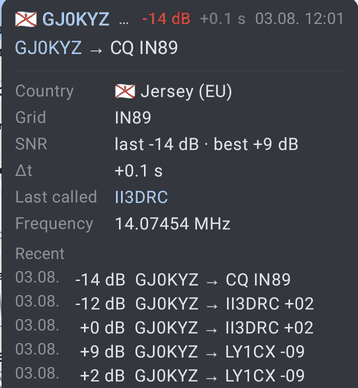

---

## Tips & Troubleshooting

**Nothing is decoded**

- Check the waterfall: are there FT8 traces in the channel (the grey area)? If
  not, the band may be closed. Try another band (see
  [Where to find FT8](#where-to-find-ft8)).
- Check that the channel frequency is the FT8 frequency of the band and that
  the channel covers the traces.
- Look at the [timing indicator](#the-timing-indicator): a red peak outside the
  grey band means the timing is off. Select **Automatic**.
- If the indicator shows no peak at all, the receiver gets no usable FT8
  signals: check the antenna, the gain and the source.

**Fewer messages than expected**

- A peak away from the centre line costs weak signals: with Internet time or
  Manual, check the timing. Automatic corrects this by itself.
- If the overload notice appears, the phone can't keep up; see
  [Processing Overload](./troubleshooting.md#processing-overload). Decoding a
  period takes a modern phone one to two seconds.

**Playing back recordings**

- Use **Automatic**. It works with any recording, whatever its time stamps.
- The messages of a recording carry the time they were originally received.
  While the recording plays, the Digital tab counts in the recording's time:
  ages, **Before this session** and the order of the Raw list follow the
  playback, as if it were received now. The time column shows the recording's
  date ("03.08. 12:00").
