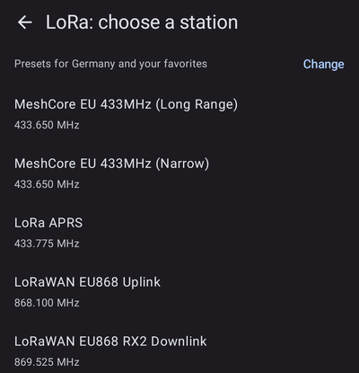
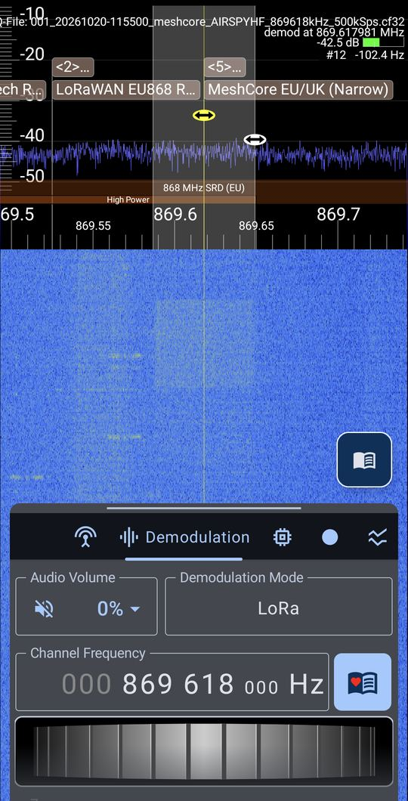
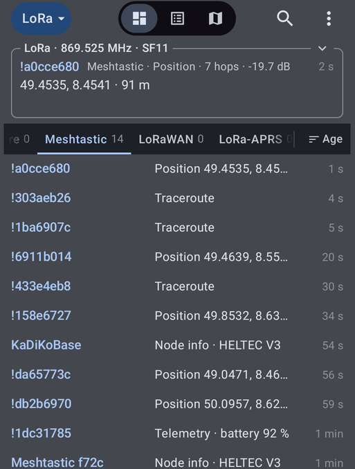
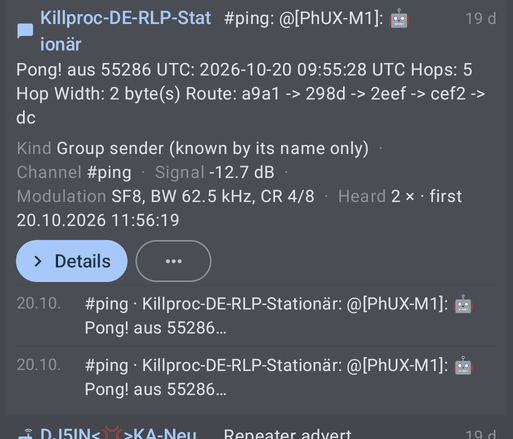
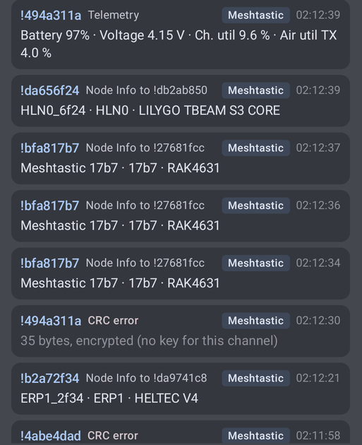
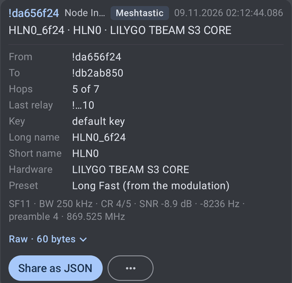

---
search:
  exclude: true
---

# LoRa

LoRa is a radio modulation for long range at very low power. Small battery
devices use it to send a few bytes over several kilometres, and several popular
networks are built on it: the **MeshCore** and **Meshtastic** mesh messengers,
**LoRaWAN** (the Internet of Things network behind countless sensors, meters
and trackers), and for radio amateurs **MeshCom** (a mesh for text and
positions) and **LoRa-APRS** (position reports).

RF Analyzer receives LoRa, decodes every frame in the channel and shows what
the five networks send: mesh nodes with their names, positions, battery and
sensor readings, text messages on public channels, the routes messages take
through the mesh, and LoRaWAN devices. It only receives; it does not transmit.

All you need is an SDR that covers the band in use (868 MHz in Europe,
915 MHz in the Americas, 433 MHz for MeshCom and LoRa-APRS) and a suitable
antenna. LoRa is part of the [Digital Extension](./digital-extension.md), which
must be installed.

---

## How LoRa Works

### Chirps

A LoRa signal is made of **chirps**: tones that sweep across the whole channel
from the lowest to the highest frequency. Each symbol is a chirp that starts at
a different frequency, and where it starts carries the data. In the waterfall a
LoRa frame looks like a block filling the channel's width, made of diagonal
lines (see the screenshot under [Controls](#controls-in-the-demodulation-tab)).

Every frame starts with a **preamble** of identical chirps, so that receivers
can find it, followed by the **sync word**, which tells the networks apart:
0x12 for MeshCore and LoRa-APRS, 0x2B for Meshtastic, 0x34 for LoRaWAN.

### Spreading factor and bandwidth

Two settings define a LoRa channel:

- The **bandwidth**: how wide the chirps sweep, usually 125 kHz (LoRaWAN,
  LoRa-APRS), 250 kHz (Meshtastic's default) or 62.5 kHz (MeshCore in Europe).
- The **spreading factor** (SF7 to SF12): how long each chirp is. Each step
  doubles the duration, which makes the signal about 2.5 dB more robust but
  halves the data rate.

This is what makes LoRa reach so far: frames can be decoded well **below the
noise**, down to about -10 dB signal-to-noise ratio at SF7 and -20 dB at SF12.
A frame also carries a **coding rate** (error correction, 4/5 to 4/8) and
usually a **checksum** (CRC) over its content.

### The networks

| Network | What it is | Content |
|---|---|---|
| **Meshtastic** | Off-grid text messenger; every node relays messages for the others | Messages on the public default channel can be read; others are encrypted |
| **MeshCore** | Mesh messenger with fixed repeaters and room servers | Node announcements (adverts), public and hashtag channel messages |
| **LoRaWAN** | IoT network: sensors and meters talk to gateways of a network operator | Device address, frame counter and a few control fields; the data itself is encrypted |
| **MeshCom** | Amateur radio mesh: text messages and positions, relayed by every node, with gateways to the internet | Everything: amateur radio may not encrypt |
| **LoRa-APRS** | Amateur radio position reports, like APRS on 2 m | Callsign, position, comment |

### Where to find LoRa

Common channels in Europe (the presets for Europe tune to these):

| Network | Frequency | Bandwidth | Spreading factor |
|---|---|---|---|
| Meshtastic (LongFast) | 869.525 MHz | 250 kHz | SF11 |
| MeshCore (EU/UK Narrow) | 869.618 MHz | 62.5 kHz | SF8 |
| LoRaWAN uplinks (devices) | 868.1, 868.3, 868.5 MHz | 125 kHz | SF7–SF12 |
| LoRaWAN downlinks (gateways) | 869.525 MHz | 125 kHz | SF12 (often SF9) |
| MeshCom | 433.175 MHz | 250 kHz | SF11 |
| LoRa-APRS | 433.775 MHz | 125 kHz | SF12 |

In the Americas, Meshtastic's default channel is at 906.875 MHz (250 kHz).
Activity depends a lot on where you are: mesh networks are busiest in and
around cities.

---

## Getting Started

The quickest way to start is the mode button in the header of the
[Digital tab](./digital-tab.md#choosing-a-mode): tap it, tap **›** next to **LoRa**
and pick a network. RF Analyzer selects the LoRa mode, tunes to the channel,
sets its bandwidth and starts the analyzer; the Overview shows the section of
the first frame received. Select
and set up your source first in the Source tab.

You can also set it up by hand: select **LoRa** as the demodulation mode in the
Demodulation tab, set the channel frequency and the channel bandwidth of the
network you want to receive.

Frames appear as soon as they are received. Mesh nodes announce themselves
every few hours, but most networks carry some traffic every minute.

---

## Controls in the Demodulation Tab

- **Channel Frequency**: the centre frequency of the LoRa channel. The channel
  is the grey area in the spectrum.
- **Channel Bandwidth**: must match the network's bandwidth (see
  [Where to find LoRa](#where-to-find-lora)): frames of another bandwidth are
  not decoded.
- **Spreading Factor**: **Auto** (the default) searches SF7 to SF12 at once.
  Select one or more spreading factors instead to search only those - SF5 and
  SF6 are searched only when selected. Fewer spreading factors need less CPU;
  frames with other spreading factors are missed.
- **Chirp Direction**: **Auto** (the default) receives both directions.
  **Normal** receives what devices send (MeshCore, Meshtastic, LoRa-APRS,
  LoRaWAN uplinks), **Inverted** what LoRaWAN gateways send (downlinks). One
  direction needs less CPU.
- **Edit MeshCore Hashtag Channels**: MeshCore's hashtag channels (`#ping`,
  `#test`, …) derive their key from the channel name, so anyone who knows the
  name can read them. Add the names of the channels used in your area to read
  their messages (see below).

All three sync words are searched. Leave the spreading factor and chirp
direction on Auto unless you know what you are looking for, or your phone is
too slow for Auto (see [Troubleshooting](./troubleshooting.md#processing-overload)).

### MeshCore Hashtag Channels

**Edit MeshCore Hashtag Channels** opens the list of hashtag channels
RF Analyzer tries in addition to its built-in ones:

- Type a channel name (with or without `#`) and tap **Add**.
- **Paste from clipboard** adds several names at once (one per line, or
  separated by commas); **Copy to clipboard** copies your list, for example to
  share it with a friend.
- The trash icon removes a channel, **Delete all** empties the list.

The **Public** channel and a set of common hashtag channels (`#test`, `#ping`,
`#echo`, `#mesh`, `#meshcore`, `#hamradio`, `#weather`, `#emergency`, `#news`
and a few more) are always active and not listed. RF Analyzer also tries a
built-in dictionary of about 2000 channel names used in Europe and North
America; a match counts only if the message decrypts to readable text.

When you add a channel, RF Analyzer decrypts the stored messages of that
channel too, so messages received before you added it appear as well.

---

## What RF Analyzer Decodes

- **Meshtastic**: text messages, positions, node information (name, hardware,
  role), telemetry (battery, voltage, channel utilisation, temperature,
  humidity, pressure, air quality, power, the node's own network statistics),
  neighbour lists with signal strengths, traceroutes (the route a message took
  and the SNR of every hop), acknowledgements and waypoints. Readable are the
  default channel of every preset and channels with the simple keys; private
  channels and direct messages stay encrypted.
- **MeshCore**: node adverts with name, type (chat node, repeater, room server,
  sensor) and position, each checked by its digital signature; messages on the
  Public channel and the hashtag channels you added; traces with the SNR of
  every hop; node discovery. Private messages, logins and requests are
  encrypted - RF Analyzer shows who they are addressed to (as a short hash) and
  their size.
- **LoRaWAN**: message type, device address and network operator, frame
  counter, port, control commands, join requests with the device's EUI and its
  manufacturer. The application data is encrypted.
- **MeshCom**: text messages to everyone, to a group or to a callsign, and
  their acknowledgements; position beacons with APRS symbol, comment, battery,
  altitude and the readings of weather sensors; the HEY beacons in which every
  node and gateway announces itself, with the signal reports of the relays;
  neighbour reports; the MeshCom server's time beacon. Every frame shows the
  route it took (the callsigns of the relays).
- **LoRa-APRS**: callsign, path, position, symbol and comment.

---

## In the Digital Tab

The decoded frames show up in the [Digital tab](./digital-tab.md). That page
explains the controls all modes share; here is what LoRa's sections, rows and
cards mean.

### Sections and the ticker

The **Overview** has one section per network, selected with the tabs in the
header line: **MeshCore** nodes, **Meshtastic** nodes, **MeshCom** stations,
**LoRaWAN** devices and **LoRa-APRS** stations. A dot marks a section that has received something since
you last looked at it. After a start, the Overview switches to the section of
the first frame received.

While LoRa is received, the **ticker** above the sections shows the newest
frame of any network: who sent it, the network, the message type, how many
hops it took, its signal-to-noise ratio and its content. Its label shows the
spreading factor of that frame. Tap the ticker to see a list of the session's
last frames.

Each row shows the node's name (or address), what it sent last and when. Sort
the rows by **Last heard**, **Frames** (how many frames it sent), **Signal
(SNR)** (of its last frame) or **Name**.

**Only intact frames count towards a node.** A frame with a CRC error is shown
in the Raw view, but doesn't create or change a node: a damaged address would
otherwise show up as a node that doesn't exist. Frames without checksum
(LoRaWAN downlinks) count when the receiver is sure about every bit. MeshCore
checks its frames itself: an advert counts only with a valid digital signature,
a channel message with a valid authentication code, and MeshCom by the checksum
every frame carries.

### MeshCore

- **Rows** are nodes, identified by their public key and shown with the name
  from their advert and an icon for their type: person (chat node), router
  (repeater), globe (room server), sensor. A row with a speech bubble is a
  **group sender**: someone heard only through channel messages, known by the
  name they put in their messages. That name can't be verified, so a group
  sender is listed separately from a node of the same name.
- The row says what the node sent last: "Repeater advert", or a channel message
  as "#test: Hello".
- The summary counts repeaters, room servers and nodes with a position.
- Opened: the node's **Kind**, **Position** (from its advert), the **Channel**
  of a group sender, **Signal** (SNR of its last frame), **Modulation** and its
  **Public key**.

### Meshtastic

- **Rows** are nodes, identified by their node number (`!1c4977b0`) and shown
  with their long name once they sent their node information.
- The row says what the node sent last: a text message, its position, its node
  information ("Node info · HELTEC V3"), "Telemetry · battery 87 %", or
  "Encrypted (no key for this channel)" for a private channel.
- The summary counts the nodes with a position.
- Opened: **Node** number, **Short name**, **Hardware**, **Role** (Client,
  Router, Tracker, Sensor, …), **Position**, **Battery** (101 % means it runs on
  external power) and voltage, **Uptime**, **Environment** (temperature,
  humidity, pressure from its sensors), **Neighbours** (the nodes it hears
  directly, with their SNR) and whether it is **Licensed** (a radio amateur
  running without encryption).

### MeshCom

- **Rows** are stations, identified by their callsign, with the APRS symbol of
  their position beacon.
- The row says what the station sent last: a text ("group 262 · Hello"), its
  position with comment, battery and altitude, "HEY · hears 4 stations", or
  "Server time beacon".
- A frame relayed by other stations counts for its sender, and also for the
  relay it was heard from: its signal (SNR) is the relay's, so a station's
  **Signal** comes only from frames it sent or relayed itself. Opened, a relay
  lists the frames it relayed.
- The summary counts the stations with a position and the gateways.
- Opened: **Position**, **Name** and **Comment** from its beacon, **Battery**,
  **Altitude**, the weather readings (**Temperature**, **Humidity**,
  **Pressure**, …), **Neighbours** (how many stations it hears directly),
  **Groups** it is in, whether it is a **Gateway** (connected to the MeshCom
  server on the internet), its **Hardware** and **Firmware**, how many frames
  it **Relayed**, **Signal** and **Modulation**.
- A frame opened shows its **Path** (from the sender over every relay), the
  **Message ID** (the same in every relayed copy), the hops left, its flags
  and the sender's hardware and firmware.

### LoRaWAN

- **Rows** are devices, identified by their device address (DevAddr, 8 hex
  digits), which the network assigns when the device joins. A device heard only
  while joining is listed by the end of its device EUI ("EUI …4A30F1C2"); after
  joining it gets a new address and a new row.
- The row shows the type of its last frame and its port ("Uplink · FPort 2");
  **FCnt** is its frame counter, which counts up with every frame it sends, and
  **SNR** how well the device is heard.
- Opened: the **Network** operator (from the device address), the **DevEUI**
  and **JoinEUI** of a join request with the manufacturer where known, and the
  last **Downlink** the network sent to the device (its type, port, the
  network's own frame counter and how well the gateway is heard) - kept apart
  from the device's frames, so the two counters don't mix.
- LoRaWAN encrypts the content: RF Analyzer shows who sends and when, not what.

### LoRa-APRS

Works like APRS on 2 m: rows are stations with their APRS symbol, position and
comment; see [AX.25 / APRS](./ax25.md#in-the-digital-tab) for what the fields
mean.

### Frames

The **Raw** view shows every frame as a card: the sender, the message type (and
the addressee of a direct message), the network as a tag, the time, and the
content. Two red words warn you:

- **CRC error**: the checksum doesn't match, some bytes are wrong. Don't trust
  the content.
- **Unreliable**: sent without checksum and received too weakly to be sure.
- **Bad signature** (MeshCore adverts): the digital signature is wrong.

Encrypted content is shown in grey ("44 bytes, encrypted (no key for this
channel)"). Tap a card for all decoded fields:

- **Meshtastic**: **From**, **To** (Broadcast or a node), **Hops** ("5 of 7":
  hops taken of the limit it was sent with), **Last relay** (the last byte of
  the node that relayed it last), **Key** (the default key or a simple key
  decrypted it), then the content: text, position, node info, every telemetry
  reading, neighbours, the route of a traceroute. **Preset** is the Meshtastic
  modem preset that fits the frame's modulation (a guess from the modulation).
- **MeshCore**: for a channel message the sender, the **Channel** and when it
  was **Sent** by the sender's clock; for an advert the name, type, position,
  time and whether its **Signature** is valid. **Route** shows how the frame
  travels (flood or direct) and the repeaters it passed, each as a short hash
  of its key. Encrypted direct messages show only the short hashes of sender
  and addressee.
- **LoRaWAN**: message type, network, device and join EUIs, flags, every MAC
  command (control commands between device and network) and the **Data rate**
  (EU868 table).

The grey **radio line** describes the reception: spreading factor (SF),
bandwidth (BW), coding rate (CR), the **SNR** in the LoRa bandwidth, the
transmitter's frequency error, the number of preamble chirps received (a hint
at the network: MeshCore sends 32, Meshtastic 16, LoRaWAN 8), **IQ inverted**
for downlinks, the checksum state
("no CRC, reliability 0.999" for frames sent without one) and the channel
frequency.

### Map

The **Map** shows every node and station with a known position: Meshtastic
nodes that sent their position, MeshCore nodes whose advert includes one, and
LoRa-APRS stations. Tap a marker to see its details and recent frames. LoRaWAN
devices don't transmit a position.

---

## Tips & Troubleshooting

**Nothing is decoded**

- Check the waterfall for LoRa frames in the channel (blocks filling the grey
  area). Frames can be decoded even when they are hard to see.
- Check the channel bandwidth: it must match the network's.
- Use a good antenna for the band, outdoors or near a window if you can. Most
  LoRa traffic is weak and short, so give it a few minutes.

**Many frames with CRC error**

These frames are just at the edge of reception. A better antenna, a filter or
an amplifier for the band helps.

**The processing overload indicator appears**

LoRa decoding needs more computing power the wider the bandwidth is. At
500 kHz an older phone may not keep up; at the usual 62.5 to 250 kHz all
current phones do.

**MeshCore or Meshtastic messages stay encrypted**

They are on a private channel or addressed to a single node. Only public
channels, MeshCore hashtag channels whose name you added, and Meshtastic
channels with a default or simple key can be read.
