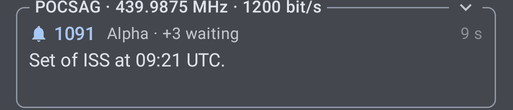
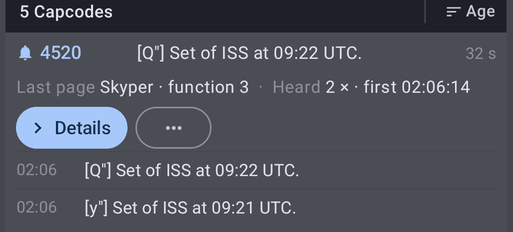
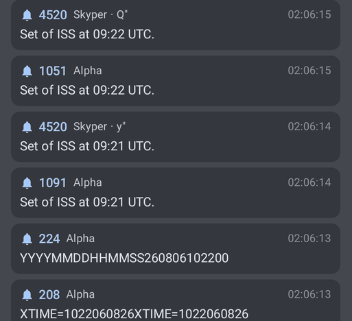
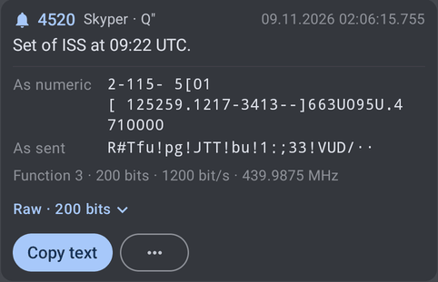

---
search:
  exclude: true
---

# POCSAG

POCSAG is the protocol of **pagers**: small receivers that beep and show a short
message. Mobile phones replaced them for most people, but paging is still used
where a message has to reach many receivers reliably and at once: fire brigades
and rescue services, hospitals, industrial sites, and commercial paging
networks. Radio amateurs run their own paging network, **DAPNET**, which sends
news, weather, satellite passes and messages between hams.

RF Analyzer decodes POCSAG at all three speeds and shows the pages per
receiver address. It only receives. All you need is a receiver for the
VHF/UHF frequencies in use - an RTL-SDR with a simple antenna works. POCSAG is
part of the [Digital Extension](./digital-extension.md), which must be
installed.

!!! warning "Not every page is meant for you"
    In many countries it is not allowed to listen to, store or pass on
    messages that are not meant for the general public, such as the pagers of
    emergency services. Check your local regulations. Amateur paging (DAPNET)
    is meant to be received by everyone.

---

## How POCSAG Works

### On the air

A paging transmitter sends a strong FM signal that jumps between two
frequencies, 4.5 kHz above and below the channel (frequency shift keying), at
**512**, **1200** or **2400** bit/s. A transmission starts with a long preamble
(so pagers can wake up), followed by batches of codewords, each protected by an
error-correcting code: RF Analyzer corrects up to two wrong bits per codeword.
In the waterfall, a POCSAG transmission is a block a few kHz wide that lasts
from a fraction of a second to several seconds.

### Capcodes

Every pager listens for its **capcode** (also called RIC, receiver identity
code): a number up to 2 097 151. A pager can have several capcodes - one for its
owner, others for the groups it belongs to - so one page can reach thousands of
pagers at once. Each page also carries a **function** (0 to 3, often called A
to D), which the pager uses to pick a ring tone or a meaning.

### Message types

- **Alphanumeric**: text (7-bit ASCII), up to a few hundred characters.
- **Numeric**: digits and a few signs (space, `.`, `-`, `U`, `[`, `]`), used by
  simple pagers and for call-back numbers.
- **Tone only**: no message at all, just the beep.

The protocol doesn't say which type a page is - the pager knows it from its
programming. RF Analyzer therefore decodes every page both ways and picks the
reading that fits (see [How the reading is chosen](#how-the-reading-is-chosen)).

### Where to find POCSAG

| Network | Frequency | Speed |
|---|---|---|
| DAPNET (amateur radio) | 439.9875 MHz | 1200 bit/s |
| Skyper | 465.970 MHz | 1200 bit/s |
| Cityruf / e*Message | 466.075 MHz | 1200 bit/s |

These are the frequencies in Germany (the presets for Germany tune to them). Other
countries use other frequencies; look for strong FM bursts between 140 and
470 MHz.

---

## Getting Started

The quickest way to start is the mode button in the header of the
[Digital tab](./digital-tab.md#choosing-a-mode): tap it, tap **›** next to
**POCSAG** and pick a network. RF Analyzer tunes to its frequency, sets the
speed to 1200 bit/s and starts the analyzer. Set up your source first in the
Source tab.

You can also set it up by hand: select **POCSAG** as the demodulation mode in
the Demodulation tab and put the channel frequency on the paging channel.
Paging networks send in bursts, often only every minute or two, so give it some
time.

---

## Controls in the Demodulation Tab

- **Channel Frequency**: the paging channel.
- **Baud Rate**: **Auto** decodes 512, 1200 and 2400 bit/s at the same time,
  so you don't need to know the speed. A fixed rate needs a little less
  processing power. 2400 bit/s also widens the channel to 25 kHz.
- There is no squelch in the digital modes: the decoder finds the
  transmissions by itself. The channel width follows the baud rate; you can
  still drag the channel's edge in the FFT plot.

---

## In the Digital Tab

The pages show up in the [Digital tab](./digital-tab.md). That page explains the
controls all modes share; here is what POCSAG's rows and cards mean.

### Overview

While POCSAG is received, the **ticker** shows the newest page: the capcode, how
it was read (Alpha, Numeric, …) and its text. When several pages arrive at once,
each is shown for a few seconds (short ones for one second), and the ticker
says how many are still waiting ("+3 waiting"). Tap the ticker to see a list of
the session's last pages.

The **Overview** lists one row per capcode, with the text of its last page.
Sort by **Last heard**, **Pages** (how many it received) or **Capcode**.

Tap a capcode to see how its last page was read and with which function, how
often and since when it was paged, and its pages. **⋯** copies the capcode or
shares the pages as JSON.

### Pages

The **Raw** view shows every page as a card: the capcode, how it was read, the
time and the text. Tap a card to see more:

- **As numeric** / **As alpha**: the same page read the other way, in case
  RF Analyzer picked the wrong reading.
- **As sent**: for a Skyper page, the text before the Skyper shift was undone.
- The grey line: the **function**, the length of the message in bits, the
  speed and the frequency.
- **Raw · 200 bits**: the message bits as received, in hex.
- **Copy text** copies the page text.

### How the reading is chosen

| Reading | When |
|---|---|
| **Tone only** | The page has no message bits at all |
| **Skyper** | The text is shifted the way the Skyper network sends its news (each character one code higher). RF Analyzer undoes the shift and shows the topic tag, for example `[PARA]`, in front |
| **Alpha** | The text reads as text, whatever the function says |
| **Numeric** | Function 0 (commonly numeric) and the page doesn't read as text |
| **Empty** | Neither reading gives anything |

Very short pages can't be told apart reliably; then the function decides. If a
page looks like garbage, open it: the other reading is often the right one.
Characters that can't be shown appear as `·`.

---

## Tips & Troubleshooting

- **Nothing decoded**: check that you see the bursts in the waterfall when a
  page is sent, and that the channel frequency is within a few kHz of them.
  Paging networks can be quiet for minutes.
- **Missing or garbled characters**: a weak or fading signal. Up to two wrong
  bits per codeword are corrected; the characters of a codeword with more errors
  are shown as �, and the rest of the page stays readable (the page's details
  say how many codewords were damaged). Many errors in a row end the page early.
- **The same page several times**: networks repeat pages, and several
  transmitters send the same page one after another (simulcast). Each copy is
  shown.
- **Overload warning**: Auto decodes three speeds at once; set the speed of
  your network instead.
