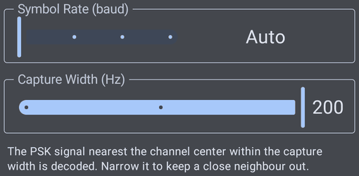
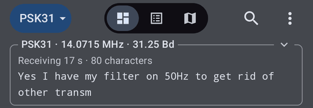
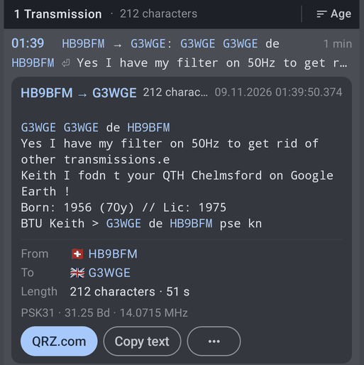

---
search:
  exclude: true
---

# PSK31

PSK31 is a keyboard-to-keyboard chat mode of radio amateurs: two stations type
to each other in real time, letter by letter, with a signal only about 60 Hz
wide. It was designed in the late 1990s to get through with very little power,
and it still does - a PSK31 signal can be read when it is barely visible in the
waterfall. Its faster variants **PSK63** and **PSK125** work the same way at two
and four times the speed.

RF Analyzer decodes all three and shows the received text as it comes in. By
default it detects the speed by itself and finds the signal near the frequency
you tune to, so you only need to tune near a signal. It only receives; it does
not transmit.

All you need is a receiver for the shortwave bands (1.8 to 30 MHz): an SDR that
covers them or one of the many public KiwiSDR web receivers (see
[KiwiSDR](./sdr-source.md#kiwisdr-specific-settings)). PSK31 is part of the
[Digital Extension](./digital-extension.md), which must be installed.

---

## How PSK31 Works

### One tone, flipped

A PSK31 transmitter sends a single tone. Information is carried by its **phase**:
at every symbol (31.25 times a second for PSK31) the tone either keeps its phase
or flips it by half a cycle. A flip is a 0, no flip a 1. To keep the signal
narrow, the transmitter fades the tone out and back in at every flip. In the
waterfall a PSK31 signal is a narrow stripe, much narrower than a voice signal.

When nobody is typing, the transmitter sends flips continuously (the **idle**
signal: two thin lines 31 Hz apart). At the end of a transmission it sends an
unmodulated tone for a moment, then stops.

### Characters

Characters use the **varicode**: frequent letters get short codes ("e" is two
bits), rare ones long codes (up to 10 bits). Codes never contain two zeros in a
row, so "00" marks the gap between two characters. This makes PSK31 about as
fast as a good typist - 50 words per minute - and lets a receiver recognize
where characters begin.

A receiver that knows which bit patterns are valid codes can repair some
errors on its own: RF Analyzer weighs every bit by how sure it is and picks the
sequence of characters that fits best.

### Variants

| Mode   | Symbol rate | Width  | Speed (words per minute) |
|--------|-------------|--------|-----------------|
| PSK31  | 31.25 baud  | ~60 Hz | ~50  |
| PSK63  | 62.5 baud   | ~120 Hz | ~100 |
| PSK125 | 125 baud    | ~250 Hz | ~200 |

PSK31 is by far the most common. The faster variants need a stronger signal for
the same quality. (QPSK31, a variant with four phases, is rare and not decoded.)

### Where to find PSK31

Around **14.070-14.073 MHz** (20 m, most activity, day and evening),
**7.040-7.043 MHz** (40 m), **3.580-3.583 MHz** (80 m), 10.142, 21.070 and
28.120 MHz. Stations call "CQ CQ CQ de" followed by their callsign and then
chat: name, location, weather, their station - often from prepared texts
("macros").

---

## Getting Started

The quickest way to start is the mode button in the header of the
[Digital tab](./digital-tab.md#choosing-a-mode): tap it, tap **Start** next to **PSK31**
and pick a band. Set up your source first (for example a KiwiSDR) in the
Source tab.

You can also set it up by hand: select **PSK31** as the demodulation mode in
the Demodulation tab and put the channel frequency on (or near) a signal. Text
appears about two seconds after it was sent.

---

## Controls in the Demodulation Tab

- **Channel Frequency**: put it on the signal. It doesn't have to be exact:
  RF Analyzer decodes the PSK signal nearest to it within the capture width and
  follows it if it drifts.
- **Capture Width** (50, 100 or 200 Hz; default 200): where RF Analyzer looks
  for a signal - the gray channel area in the waterfall. With 200 Hz you can be
  up to 100 Hz off. If two stations are close together, the one nearer the
  channel frequency is decoded; when it pauses, the other one may be decoded in
  the meantime - narrow the capture width to keep it out. You can also drag the
  edge of the channel area.
- **Symbol Rate**: **Auto** (default) detects PSK31, PSK63 or PSK125 for every
  transmission. Choose a fixed rate if you know it: text then appears a little
  sooner and RF Analyzer uses less battery.
- **Audio Volume**: you can listen to the signal like a USB receiver and hear
  its warbling tone. Decoding doesn't need audio.

RF Analyzer suppresses text when there is no PSK signal, so tuning across an
empty band or other digital modes doesn't fill the screen with random
characters.

---

## In the Digital Tab

The received text shows up in the [Digital tab](./digital-tab.md). That page
explains the controls all modes share; here is what is special about PSK31 (and
RTTY, which works the same way).

While PSK31 is received, the **ticker** above the list shows the text as it
comes in, the newest line at the bottom. Its first line says how long the
transmission has been running and how many characters it has so far; its label
shows the symbol rate in use (`31.25 Bd` for PSK31, `62.5 Bd` for PSK63,
`125 Bd` for PSK125). Tap the ticker to open it and read more of the text.

When the station stops transmitting (a few seconds of silence, or a change of
the symbol rate), the **transmission** becomes a row of the Overview: its start
time, the callsigns RF Analyzer recognized and the beginning of the text, with
⏎ marking line breaks. Tap a row to open it:

- the whole **text**, callsigns highlighted,
- **From** and **To** with the country flag,
- **Length**: characters and duration,
- the grey line: mode, symbol rate and frequency,
- **QRZ.com** looks up the sender; **⋯** has PSKReporter, the other station's
  QRZ.com page, copying a callsign and sharing as JSON. **Copy text** copies the
  whole text.

RF Analyzer recognizes callsigns from the usual phrases: "G3WGE de HB9BFM"
gives From HB9BFM, To G3WGE; "CQ CQ de GW5PH" gives From GW5PH. It looks for
callsigns of the common form (one to three letters, a digit, one to four
letters), so a few callsigns, for example those starting with a digit
(9A1AA) or with a digit in the prefix (S51ABC), are not recognized.

Sort the rows by **Start time**, **Duration** or **Length**. The summary counts
the characters of all listed transmissions. Very long transmissions are split
into parts, like [RTTY's](./rtty.md#in-the-digital-tab).

In the top right corner of the spectrum, the diagnostics show the number of
characters received, the variant in use (`PSK31`, `PSK63` or `PSK125`) and
how far the signal is from the channel frequency (`-2.2 Hz`). The scatter plot
below shows one dot per received symbol: two tight clouds left and right mean
a clean signal; under noise or fading they spread toward the middle.

---

## Tips & Troubleshooting

- **No text at all**: check that the signal is inside the capture width (the
  gray channel area) and that it really is PSK31: a narrow stripe, not two lines
  switching back and forth (that is RTTY) and not a wide block (other digital
  modes).
- **Text from the wrong station**: two signals within the capture width - put
  the channel frequency on the one you want and narrow the capture width.
- **Weak signals**: RF Analyzer decodes PSK31 down to about -13 dB
  signal-to-noise ratio (in 2.5 kHz); below that more and more characters drop
  out. PSK63 and PSK125 need about 3 and 6 dB more.
- **A few random characters on an empty band**: rare noise bursts or carriers
  can briefly look like PSK. They show up as very short transmissions with
  nonsense text.
- **Nonsense text on another mode**: wide multi-carrier digital modes (a block
  of signal 1-3 kHz wide) can look like PSK31 to the receiver now and then.
  While such a signal covers the channel, expect a few garbled characters a
  minute.
- **Fading**: PSK31 copes well with slow fading; while a signal is gone, its
  text pauses and resumes when it comes back.
