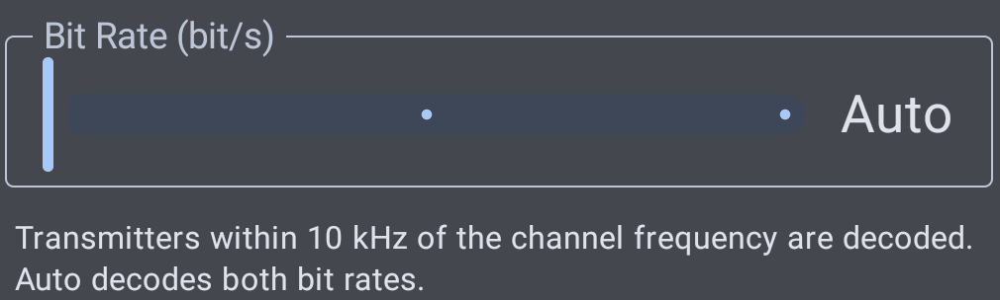
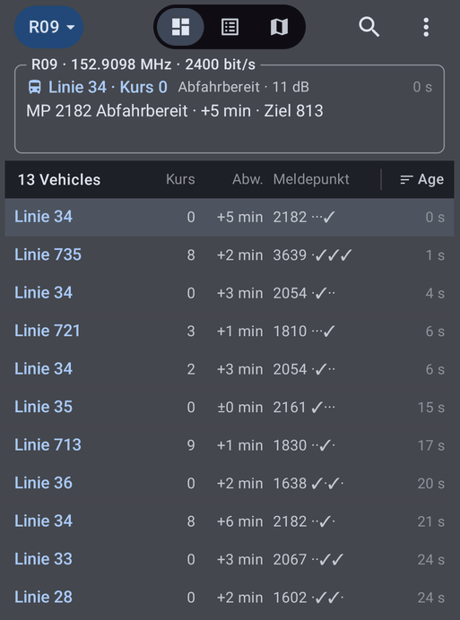
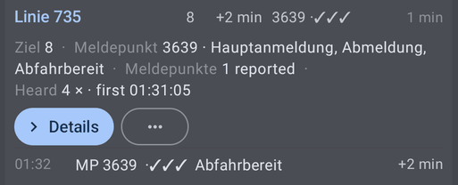
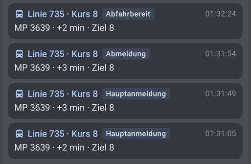
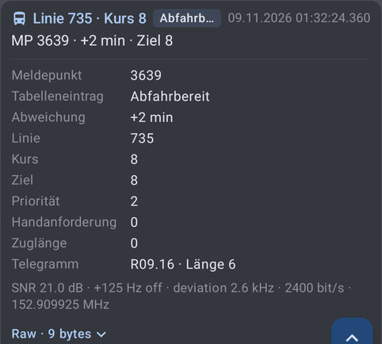

---
search:
  exclude: true
---

# R09

R09 is the radio protocol trams and buses in Germany (and some neighboring
countries) use to request **priority at traffic signals** - the "green wave"
that gives a public transport vehicle an early or extended green light. It has
nothing to do with GPS tracking or timetable information: it is a short
request/notification between a vehicle and the next traffic signal it is
approaching.

RF Analyzer decodes these telegrams and shows which lines and runs are on the
move near you, which reporting points they pass and how late they are running.
It only receives; it is not involved in the actual traffic light control.

All you need is a receiver for the VHF channel of your city (around 150 to
170 MHz) - an RTL-SDR with a simple antenna works. R09 is part of the
[Digital Extension](./digital-extension.md), which must be installed.

---

## How R09 Works

### The idea behind it

Trackside receivers near a traffic signal listen for short radio telegrams sent
by approaching buses and trams. When a valid telegram arrives, the signal
controller can shorten the wait, extend a green phase or insert an extra one,
so the vehicle gets through with as little delay as possible.

### On the air

All vehicles of a city send on one VHF channel, as short FM bursts: about a
tenth of a second of unmodulated carrier, then the telegram itself, a fast
two-tone data signal at **2400 bit/s** (some systems use **1200 bit/s**). Every
telegram is sent two or three times in a row, a fraction of a second apart, so
the trackside receiver gets a second chance - and so does RF Analyzer, which
shows such repeats once: a telegram identical to one received less than two
seconds earlier is not listed again. In the waterfall, R09 traffic looks like short dashes on the channel; on a busy
channel there are several per second.

### What's inside a telegram

- **Linie (Line)** and **Kurs (Run)** - together identify the transit route
  and the scheduled run on it. There is no vehicle ID in the protocol, so
  RF Analyzer uses the line/run/destination combination as a stand-in identity
  to group the telegrams of what is presumably the same vehicle.
- **Meldepunkt (Reporting point)** - a number identifying *which* traffic
  signal or detection point this telegram is meant for. Meldepunkt numbers are
  assigned locally by the transit authority, so the same number can mean a
  different place in a different city. RF Analyzer cannot translate it into a
  location.
- **Ziel (Destination number)** - an internal code for the vehicle's
  destination, again only meaningful with local knowledge of the network.
- **Priorität (Priority)** and **Handanforderung (manual request by the
  driver)** - how urgently priority is requested.
- **Zuglänge (Train length)** - for coupled trams, how many cars are in the
  consist.
- **Abweichung (Schedule deviation)** - how many minutes early or late the
  vehicle is running.

### The four telegram types

A vehicle doesn't send just one telegram per signal - it sends a short sequence
as it approaches, arrives at and leaves each reporting point. RF Analyzer shows
the type as a small tag (**Tabelleneintrag**, the telegram's table entry):

| Type | Meaning |
|---|---|
| **Voranmeldung** (pre-announcement) | An early heads-up, sent while the vehicle is still some distance away. |
| **Hauptanmeldung** (main announcement) | The actual priority request, sent shortly before reaching the signal. |
| **Abmeldung** (cancellation) | Sent once the vehicle has cleared the intersection: the signal can return to normal operation. |
| **Abfahrbereit** (ready to depart) | Used at stops directly in front of a signal: sent the moment the vehicle is ready to pull away (for example when the doors close), so the signal can time the green phase from that moment. |

Seeing all three (or four) types for the same reporting point means you
received the complete sequence of a vehicle passing that intersection.

---

## Getting Started

The quickest way to start is the mode button in the header of the
[Digital tab](./digital-tab.md#choosing-a-mode): tap it, tap **Start** next to **R09** and
pick your city (Berlin, Dresden, Karlsruhe/Ulm, Heidelberg). Set up your source
first in the Source tab.

You can also set it up by hand: select **R09** as the demodulation mode in the
Demodulation tab and put the channel frequency on your city's R09 channel.
Telegrams appear in the Digital tab as soon as a vehicle passes a reporting
point within range - on a quiet channel that can take a few minutes.

---

## Controls in the Demodulation Tab

- **Channel Frequency**: your city's R09 channel. It doesn't have to be exact:
  RF Analyzer decodes every transmitter within **±10 kHz** of it (the gray
  channel area is 20 kHz wide), which also covers the frequency error of
  inexpensive receivers. Each telegram shows how far off it was (see below).
- **Bit Rate**: **Auto** (default) decodes 2400 and 1200 bit/s telegrams
  alike, without losing any sensitivity at 2400 bit/s. If you know your city
  uses 2400 bit/s (most do), choosing it halves the processor load.

---

## In the Digital Tab

The telegrams show up in the [Digital tab](./digital-tab.md). That page explains
the controls all modes share; here is what R09's rows and cards mean.

### Overview

The **Overview** lists the vehicles RF Analyzer has heard - one row per line,
run and destination (R09 carries no vehicle number, so this combination stands
in for one). The columns:

- **Linie**: the line number.
- **Kurs**: the run on that line.
- **Abw.** (Abweichung): the schedule deviation of the latest telegram, in
  minutes. **+2 min** is two minutes late, **−1 min** one minute early.
- **Meldepunkt**: the last reporting point, followed by four marks for the four
  telegram types in the order of the table above. `1602 ·✓✓·` means the
  Hauptanmeldung and the Abmeldung were received there. The marks start over
  when the vehicle reaches the next reporting point (or the same one again more
  than five minutes later).
- **Ziel**: the destination number, only on wider screens. Telegrams of the
  short types R09.14 and R09.15 carry none and show 0.
- The last column: **Age** (how long ago it was heard) or, sorted by
  **Telegrams**, how many telegrams it sent.

The summary next to the count says how many different lines are in the list
("5 Linien"). Sort by **Last heard**, **Telegrams** or **Linie**.

While R09 is received, the **ticker** above the list shows the newest telegram:
line, Kurs, type, its signal-to-noise ratio, and below it the reporting point,
the deviation and the destination. Its label shows the bit rate it was
received at.

Telegrams of the shortest types (R09.10 to R09.13) carry no Kurs; they appear
in the Raw view only.

### A vehicle's reporting points

Tap a row to see the vehicle's history: the facts (destination, the last
Meldepunkt with the telegram types received there, how many different
reporting points it reported, how often and since when it was heard) and one
line per **visit** of a reporting point, newest first, with its marks, the
latest telegram type and the deviation:

Tap a visit to see its telegrams:

### Telegrams

The **Raw** view shows every telegram as a card: the vehicle, the type, the
time, and below it the reporting point, the deviation and the destination. Tap
a card for all fields and the reception details:

- **Meldepunkt**, **Tabelleneintrag** (the telegram type), **Abweichung**,
  **Linie**, **Kurs**, **Ziel**: as above.
- **Priorität** (0-3) and **Handanforderung** (0-3): how urgently priority is
  requested, and whether the driver requested it by hand.
- **Zuglänge** (0-7): for coupled trams, how many cars are in the consist.
- **Telegramm**: the telegram type R09.10 to R09.18; the last digit is its
  length (Länge), which decides which fields it carries.

The grey line below the fields describes the reception:

- **SNR**: the signal-to-noise ratio of the telegram (in 10 kHz).
- **off**: how far the transmitter was from your channel frequency. If all
  telegrams show about the same value, it is your receiver's frequency error;
  you can correct the channel frequency or your source's
  [frequency correction](./sdr-source.md#frequency-correction) by it.
- **deviation**: how far the transmitter's FM swings (most send about 2 kHz,
  some up to 6 kHz). Shown for telegrams above 8 dB SNR.
- The bit rate (2400 or 1200 bit/s) and the frequency the telegram was
  received on.

R09 does not appear on the **Map**, since telegrams carry no position - only the
locally assigned reporting point numbers.

---

## Tips & Troubleshooting

- **Nothing decoded**: check that the channel frequency is within ±10 kHz of
  your city's R09 channel, and that you see short dashes in the waterfall when
  a tram or bus passes. R09 traffic comes in bursts: vehicles only send at
  reporting points, so a quiet channel can stay silent for minutes.
- **Weak signals**: RF Analyzer decodes about half of the telegrams at 0.5 dB
  signal-to-noise ratio (in 10 kHz) and nearly all from 4 dB - bursts barely
  visible in the waterfall often still decode. A better antenna position
  (high, outdoors, away from electronics) helps more than gain.
- **Vehicles on the move**: a tram or bus at speed causes fast fading, and some
  telegrams are lost in it; the repeated copies usually get through.
- **The same telegram at a different frequency, far from your channel**: an
  overloaded receiver (an RTL-SDR with high gain near strong transmitters) can
  produce copies of strong signals elsewhere. Reduce the gain.
- **Overload warning**: decoding works in bursts, so a very busy, strong channel
  can briefly need a lot of processor time. Set the bit rate to 2400 bit/s
  instead of Auto - it halves the load.
