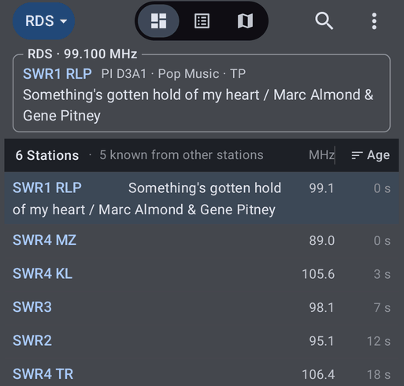
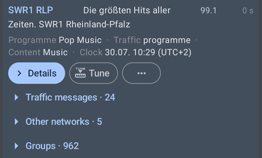
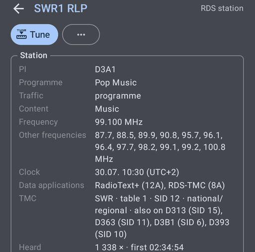
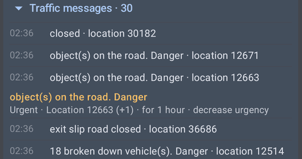
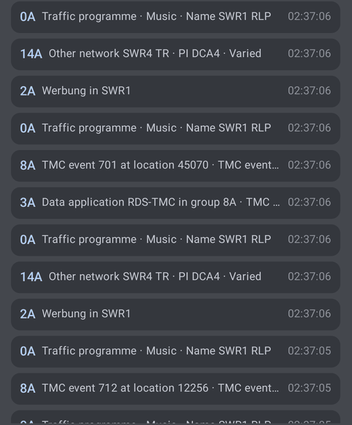

---
search:
  exclude: true
---

# RDS (Broadcast FM)

**RDS** (Radio Data System) is the data signal FM broadcast stations send along
with their programme: the station name your car radio shows, the radio text
with the song and artist, the programme type, the time, the other frequencies
of the same programme - and in many countries **TMC**, coded traffic messages
for navigation systems.

RF Analyzer decodes RDS while you listen to a station in the **FM (wide)** mode,
lists the stations it heard and what they sent, and decodes the traffic
messages. It only receives. Any SDR that covers 87.5-108 MHz works. RDS is
part of the [Digital Extension](./digital-extension.md), which must be
installed.

---

## How RDS Works

An FM station sends RDS as a quiet data signal at 57 kHz in its FM multiplex,
above the stereo signal - at 1187.5 bit/s, about 11 **groups** per second. Each
group is 104 bits: four blocks, each with its own error check. The first block
of every group is the station's **PI code** (programme identification), four
hex digits like `D3A1`: the same programme has the same PI code on all its
frequencies. The second block says which **group type** it is; each type
carries one kind of information:

| Group | Content |
|---|---|
| **0A**, **0B** | Station name (PS, 8 characters, sent in four parts), traffic flags (TP/TA), music/speech; 0A also the alternative frequencies (AF) |
| **2A**, **2B** | Radio text (up to 64 characters), sent in parts |
| **3A** | Announces which group carries an application, for example traffic messages (TMC) in 8A |
| **4A** | Date and time, about once a minute |
| **8A** | TMC traffic messages |
| **14A** | Other networks (EON): name, programme type, traffic flags and frequencies of other programmes of the same broadcaster |
| others | Programme item numbers, radio paging, RadioText+ (song title and artist as separate fields), programme type names, ... - counted, but not decoded |

Programme types (PTY) are numbers with names: 10 is "Pop Music" in Europe. The
US (RBDS) uses another list; **RDS Programme Types** in the Demodulation tab
picks the list of your country automatically (see
[Location](./settings.md#location)), or set it there by hand.

**TP** (traffic programme) means the station broadcasts traffic announcements;
**TA** (traffic announcement) is set while one is on air.

---

## Getting Started

The quickest way to start is the mode button in the header of the
[Digital tab](./digital-tab.md#choosing-a-mode): tap it, then **Start** next to
**RDS**. RF Analyzer selects **FM (wide)** with **Stereo & RDS** switched on and
tunes to the FM band (staying on your station if you are already listening to
one).

By hand: select **FM (wide)** in the Demodulation tab, switch on
**Stereo & RDS** and tune to a station (see
[Stereo & RDS](./demodulation.md#stereo-rds)). RDS needs a reasonably strong
signal; the station name usually appears within a few seconds.

---

## In the Digital Tab

The decoded data shows up in the [Digital tab](./digital-tab.md) under the mode
**RDS**. That page explains the controls all modes share; here is what RDS's
rows and cards mean.

### Overview

While RDS is received, the **ticker** shows the station you are listening to:
its name, PI code, programme type, the traffic flags, and its radio text.

The **Overview** lists every station, one row per PI code: its name, its radio
text and its frequency (**MHz**). The station being received is pinned on top
with a light background. Stations that your station announces as **other
networks** (EON) are listed too, with the first frequency announced for them;
the summary counts them ("5 known from other stations"). Sort by **Last heard**,
**Groups** (how many groups were received from it), **Name** or **Frequency**.

### A station

Tap a station to open it:

- **Programme**: the programme type; **Traffic**: whether it is a traffic
  programme and whether an announcement is on now; **Content**: music or
  speech; **Clock**: the station's date and local time, with its offset from
  UTC.
- **Tune** switches the receiver to the station's frequency.
- **Traffic messages**: the TMC messages the station currently broadcasts (see
  below).
- **Other networks**: the other programmes it announces, each with its
  frequencies; tap a frequency to tune to it.
- **Groups**: how many groups of each type were received, with what the newest
  one said. Tap a type to see that group.

**Details** shows everything on one page: PI code, all alternative frequencies
(**Other frequencies**), the **Data applications** the station announces
(RadioText+, RDS-TMC, …) and its **TMC** service: the provider, the location
table, the service ID and the other stations that carry the same service.

### Traffic messages (TMC)

Each line is one message: the event in words ("exit slip road closed", "18
broken down vehicle(s). Danger") and the **location** code it applies to. Tap a
message for its details: the urgency (urgent messages in orange, extremely
urgent in red), how many further locations it covers (**+1**), the direction,
how long it is expected to last, and further hints like a diversion or a speed
limit.

The locations are numbers in the national location table of your country (the
navigation system translates them into road and junction); RF Analyzer shows
the numbers. A message stays in the list while the station repeats it, and
disappears when it expires or isn't repeated for half an hour.

### Groups

The **Raw** view shows every group as a card: its type and what it said ("0A
Traffic programme · Music · Name SWR1 RLP"). There are about 11 per second, so
RF Analyzer keeps only the newest 20 000 (about half an hour of one station).
While RDS is received, the list moves constantly; scroll down a little first,
then it holds still and you can open a card. An opened card shows each decoded
field and, under **Blocks**, the four blocks as hex and bits.

---

## Tips & Troubleshooting

- **No RDS**: check that **Stereo & RDS** is on, and that the station is strong
  (the stereo pilot and RDS need more signal than mono audio). Not every station
  sends RDS.
- **The station name changes all the time**: some stations scroll text through
  the 8-character name field. RF Analyzer shows what was received last.
- **Radio text with gaps**: the text is sent in parts; missing parts are filled
  in as they arrive.
- **Wrong programme type names**: check your [Location](./settings.md#location),
  or set **RDS Programme Types** in the Demodulation tab by hand. The stored
  stations are renamed too.
