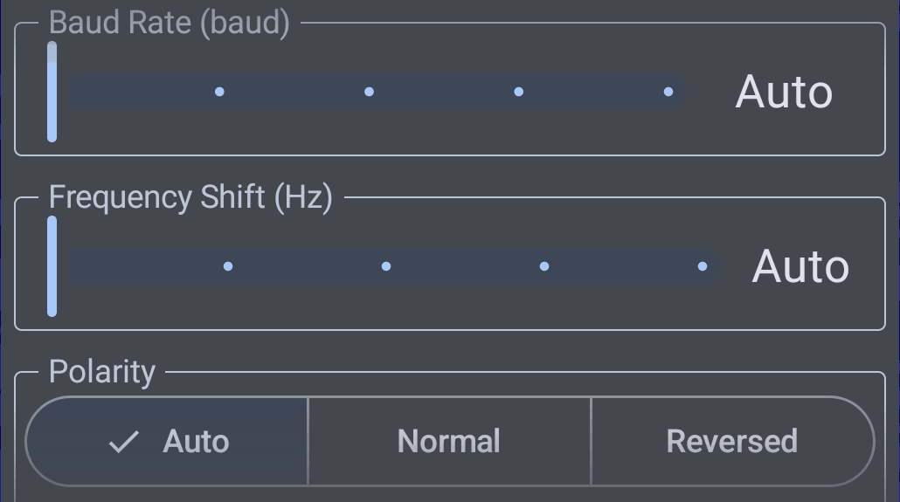
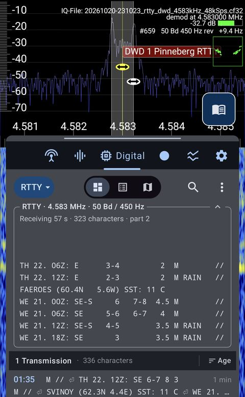
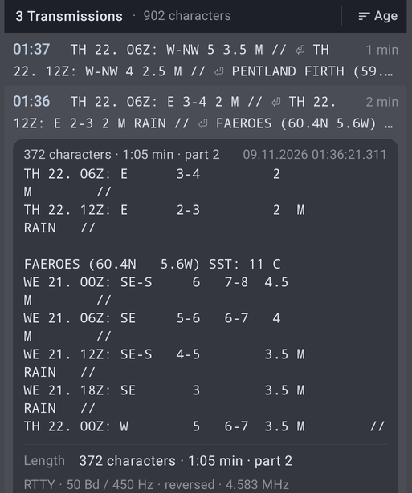

---
search:
  exclude: true
---

# RTTY

RTTY (radioteletype) is one of the oldest digital modes still on the air: the
teleprinter signal of the 20th century, sent over radio. Radio amateurs use it
for contacts and in popular contests, and some utility stations still broadcast
with it, most prominently the **German weather service (DWD)**, which sends
weather reports for shipping around the clock.

RF Analyzer decodes RTTY and shows the received text as it comes in. By default
it detects everything about the signal by itself - speed, shift, polarity and
the exact frequency - so you only need to tune near a signal. It only receives;
it does not transmit.

All you need is a receiver for the frequencies in use: shortwave (1.8 to 30 MHz)
for most RTTY, longwave for DWD's 147.3 kHz transmitter. An SDR that covers them
or one of the many public KiwiSDR web receivers works (see
[KiwiSDR](./sdr-source.md#kiwisdr-specific-settings)). RTTY is part of the
[Digital Extension](./digital-extension.md), which must be installed.

---

## How RTTY Works

### Two tones

An RTTY transmitter sends one of two tones at any moment: **mark** or **space**.
Every bit of a character is one of them. The distance between the two tones is
the **shift**; in the waterfall an RTTY signal looks like two parallel lines
(see the screenshot under [In the Digital Tab](#in-the-digital-tab)).

The tones change at a fixed rate, the **baud rate**: 45.45 baud (amateur radio)
means each bit lasts 22 ms. Common combinations:

| Who                         | Baud rate | Shift  |
|-----------------------------|-----------|--------|
| Radio amateurs              | 45.45     | 170 Hz |
| DWD weather (shortwave)     | 50        | 450 Hz |
| DWD weather (147.3 kHz)     | 50        | 85 Hz  |
| Other utility stations      | 50, 75, 100 | 425, 450, 850 Hz |

### Characters

Each character is a 5-bit code (the Baudot or ITA2 alphabet) between a start
bit and a stop bit, so a receiver can find where a character begins. Five bits
are only enough for 32 codes, so the alphabet has two halves: **letters** and
**figures** (digits and punctuation). Special codes switch between them, and
the receiver stays in the current half until the next switch. If a switch code
is lost to noise, the following characters come out in the wrong half - "599"
appears as "TOO". This is normal for RTTY and fixes itself at the next switch.

Transmitters also disagree on what a space does: amateur software assumes that
the receiver returns to letters after every space ("unshift on space"), the DWD
does not. RF Analyzer recognizes the convention from the switch codes the
transmitter sends.

### Polarity

Whether mark is the higher or the lower of the two tones is a convention.
Radio amateurs send mark on the higher frequency, many utility stations,
including the DWD, on the lower one. A receiver with the wrong polarity prints
only garbage.

### Where to find RTTY

- **DWD weather**: 147.3 kHz, 4583 kHz, 7646 kHz and 10100.8 kHz, day and
  night. Between reports the stations send a fixed loop ("RYRYRY…", "CQ CQ CQ DE
  DDK2 DDH7 DDK9", the list of frequencies), so there is always something to
  receive.
- **Amateur radio**: around 14.080–14.100 MHz (20 m), 7.040–7.050 MHz (40 m)
  and 3.580–3.600 MHz (80 m). On contest weekends these segments are full of RTTY
  signals.

---

## Getting Started

The quickest way to start is the mode button in the header of the
[Digital tab](./digital-tab.md#choosing-a-mode): tap it, tap **Start** next to
**RTTY** and pick one of the DWD frequencies or the 20 m amateur segment. Set up
your source first (for example a KiwiSDR) in the Source tab. The DWD targets
set the DWD's known settings (50 baud, 450 Hz shift - 85 Hz on 147.3 kHz -
reversed polarity), the 20 m target sets everything to Auto.

You can also set it up by hand: select **RTTY** as the demodulation mode in the
Demodulation tab and put the channel frequency on the signal, between its two
tones. The text appears a few seconds after the signal starts, while RF Analyzer
works out the settings - including the beginning, which it fills in once it
knows them.

---

## Controls in the Demodulation Tab

- **Channel Frequency**: the middle between the two tones. It doesn't have to be
  exact: RF Analyzer finds the tones within **±400 Hz** of it and follows them
  if the signal drifts. This also covers the frequency error of most receivers.
- **Baud Rate**: **Auto** (default) tries 45.45, 50, 75 and 100 baud and keeps
  the one that fits the signal. Choose a fixed value if you know it - the text
  then starts a little sooner, and other rates (for example 110 baud) need it.
- **Frequency Shift**: **Auto** (default) measures the distance between the two
  tones. A fixed shift also sets the channel width to it, so you can check by eye
  that the gray channel area matches the signal.
- **Polarity**: **Auto** (default) decides which tone is mark. **Normal** (mark
  is the higher frequency) is the amateur convention, **Reversed** the one of
  the DWD and many other utility stations.
- **Audio Volume**: you can listen to the signal like a USB receiver and hear
  the two tones. Decoding doesn't need audio.

RF Analyzer suppresses text when there is no RTTY signal, so tuning across an
empty band or listening to a noisy pause between two transmissions doesn't
fill the screen with random characters.

---

## In the Digital Tab

The received text shows up in the [Digital tab](./digital-tab.md). That page
explains the controls all modes share; here is what is special about RTTY.

While RTTY is received, the **ticker** above the list shows the text as it
comes in, the newest line at the bottom. Its first line says how long the
transmission has been running and how many characters it has so far; its label
shows the settings in use (in Auto mode the detected ones), for example
`RTTY · 4.583 MHz · 50 Bd / 450 Hz`. Tap the ticker to open it to about half
the drawer and read more of the text.

When the signal has been silent for a few seconds (or the settings change), the
**transmission** ends and becomes a row of the Overview: its start time, the
callsigns RF Analyzer recognized ("DL2OCE → KO4IEG", see [PSK31](./psk31.md#in-the-digital-tab))
and the beginning of the text, with ⏎ marking line breaks. Transmissions shorter
than five characters are dropped as noise.

Stations like the DWD send for hours without a pause. RF Analyzer splits such
**long transmissions** into parts: after a minute or 1 500 characters, a part
ends at the next line break (at the latest after three minutes or 4 000
characters). The ticker shows the part number ("part 2"); each part becomes its
own row.

Tap a row to open it:

- the whole **text**, in the teleprinter's fixed-width font,
- **From** and **To** with the country flag, when callsigns were recognized,
- **Length**: characters, duration and part number,
- the grey line: mode, baud rate, shift, polarity (normal or reversed) and
  frequency,
- buttons to look up the callsign (**QRZ.com**), to **Copy text** and in **⋯**
  more (PSKReporter, copying a callsign, sharing as JSON).

Sort the rows by **Start time**, **Duration** or **Length**. The summary
counts the characters of all listed transmissions. The Overview lists the
newest 500 transmissions; the search finds older ones too.

In the top right corner of the spectrum, the diagnostics show the number of
characters received, the settings in use (for example `50 Bd 450 Hz rev`) and
how far the tones are from the channel frequency (`+9.4 Hz`). The scatter plot
below shows one dot per received bit: two tight clouds left and right mean a
clean signal; under noise or fading they spread and move toward the middle.

---

## Tips & Troubleshooting

- **No text at all**: check that the two tones are inside ±400 Hz of the channel
  frequency, and that the signal really is RTTY (in the waterfall: two parallel
  lines, tones switching rapidly). With fixed settings, try Auto.
- **Only garbage**: the polarity or the baud rate is wrong - set them to Auto,
  or try the other polarity.
- **Digits where letters should be, or the other way round**: a lost letters/
  figures switch (see [Characters](#characters)); it fixes itself at the next
  switch.
- **Weak signals**: RF Analyzer decodes RTTY down to about -8 dB signal-to-noise
  ratio (in 2.5 kHz). Below that, characters drop out; the text stays readable
  longer than you might expect, because missing letters are easy to fill in.
- **Fading**: shortwave signals often fade in and out. RF Analyzer weighs each
  tone by its current strength, so a signal whose two tones fade differently
  (selective fading) still decodes.
