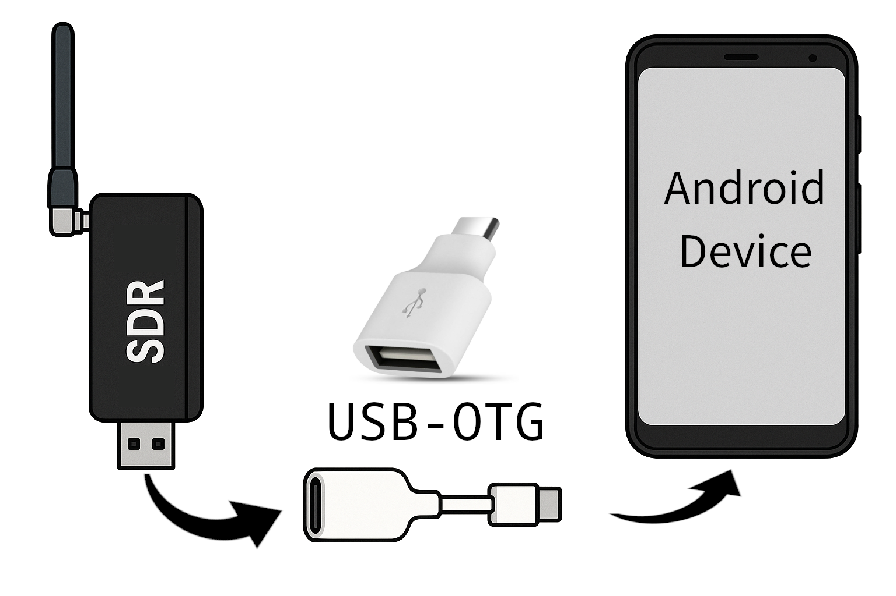

# Installation & Setup

This section explains how to install the RF Analyzer app and connect a source
for RF signals. Details about the configuration of the SDR can be found in the
section [SDR Source](./sdr-source.md).

## Installation

### Installing the App

The app can be downloaded via the Google Play Store. Use the following link:

[https://play.google.com/store/apps/details?id=com.mantz_it.rfanalyzer](https://play.google.com/store/apps/details?id=com.mantz_it.rfanalyzer)

<a href="https://play.google.com/store/apps/details?id=com.mantz_it.rfanalyzer"><p align="center"></p></a>


You can try RF Analyzer for free for 60 minutes of operating time. A small pill
above the control drawer shows the time left (for example "Trial 42m"); tap it
for details. Once the time is used up, each start still runs for 30 seconds.

If you like it, a one-time in-app purchase of the **Full Version** unlocks it
for good - no subscriptions, no accounts, no ads. **Purchase options** in the
About tab or in the trial pill's dialog opens a sheet with its Google Play
price. Purchases belong to the Google account that is active in the Play Store
and come back by themselves after reinstalling or on a new phone. The About tab
shows what you bought (**Purchase details**); **Check again** asks Google Play
anew.

This app is a hobby project, built with passion and countless hours of work.
Supporting the app helps me continue developing and improving it. Thank you! 🙏

### Drivers

No driver app is needed: RF Analyzer has built-in drivers for every supported
SDR - RTL-SDR, HackRF, Airspy, Airspy HF+ and HydraSDR. (Up to version 2.2,
the RTL-SDR needed the separate "RTL2832U driver" app; it is no longer used and
can be uninstalled.)

## Connecting SDR Hardware

### SDRs via USB

The SDR is connected via USB to your Android device using a
[USB OTG adapter](https://en.wikipedia.org/wiki/USB_On-The-Go). You might have
received such an adapter with your phone as it is usually used to transfer data
from your old phone to the new one.



When the analyzer starts with the SDR for the first time, Android asks whether
RF Analyzer may access the USB device. Check **Always open RF Analyzer when …
is connected** if you don't want to be asked each time.

RF Analyzer selects the matching source type by itself when an SDR is plugged
in while the app is open (or when you return to the app after plugging it in).
With **Start When an SDR Is Plugged In** in the Settings tab, plugging it in
also starts the analyzer.

### RTL-SDR via TCP

The RTL-SDR can be set up on a computer and accessed/operated via the network.
On your host computer, execute `rtl_tcp` to start a SDR server. The following
command line starts the server on TCP port 4242 assuming the IP address of your
host is 192.168.0.42:

```shell
rtl_tcp -a 192.168.0.42 -p 4242
```

Select **RTLSDR** in the Source tab, enable **External Server (rtl_tcp)** and
enter the server's **DNS Name / IP Address** and **Port**. Then start the
analyzer with the **Play** button. On Android 17 and newer, a server in your own
network needs RF Analyzer's local network permission (see
[External RTL-SDR Server](./sdr-source.md#external-rtl-sdr-server)).

!!! warning "Firewall might block access to the server"
    If your host computer is behind a firewall or has a local firewall
    installed, RF Analyzer might not be able to connect to the port. In this
    case, add an exception to the firewall to allow incoming traffic to the
    port specified in `rtl_tcp`.

### KiwiSDR Web Receivers (No Hardware Needed)

Select **KiwiSDR (web)** in the Source tab and tap **Choose from Public List**:
pick a receiver from the list or the map, and the analyzer starts. All you need
is an internet connection. See [KiwiSDR](./sdr-source.md#kiwisdr-specific-settings) for details.

### File Source (Playback of Recordings and IQ Files)

RF Analyzer plays back IQ files in these formats (in-phase **I** first, then
quadrature **Q**):

- **RTLSDR**: 8-bit **unsigned** (`.cu8`, e.g. from `rtl_sdr`)
- **HACKRF**: 8-bit **signed** (`.cs8`, e.g. from `hackrf_transfer -r`)
- **AIRSPY** / **HYDRASDR**: 16-bit signed (`.cs16`)
- **AIRSPYHF**: 32-bit float (`.cf32`, also RF Analyzer's baseband recordings)

Select **File Source** in the Source tab, then **Open File** for a file from
storage or **View Recordings** for one of your recordings.

After opening a file from storage, check **Tune-Frequency**, **Sample Rate** and
**File Format**: if they are wrong, the file doesn't play correctly. RF Analyzer
fills them in from the file name where it can (see
[File Source](./sdr-source.md#file-source-settings)), but that doesn't always succeed.

---

## Start the Analyzer

The [Quickstart](./quickstart.md) section briefly explains all necessary steps to
receive signals with the app. Detailed information about all UI elements can be
found in the section [User Interface](./ui-overview.md) and the following
sections ([SDR Source](./sdr-source.md), [FFT & Waterfall Display](./fft.md),
[Demodulation](./demodulation.md), [Recording](./recording.md) and
[Settings](./settings.md)).
